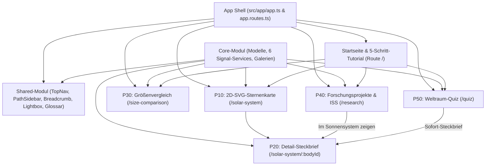

# SSI App – Solar System Info App

> **Live-Demo (GitHub Pages):** **[https://j-moessmer.github.io/BITLC-Angular-Solarsystem-Finalproject/](https://j-moessmer.github.io/BITLC-Angular-Solarsystem-Finalproject/)**

Kindgerechte, interaktive **Angular-22-Single-Page-Application (SPA)** zur Erkundung unseres Sonnensystems, der 7 astronomischen Bahnelemente, maßstabsgetreuer Größenvergleiche, internationaler Raumfahrtmissionen und eines Weltraum-Quiz.

Entwickelt als Abschlussprojekt im **Modul Angular** (`BITLC NE5 FIAE WS26` – Fachinformatiker für Anwendungsentwicklung) bei der **BITLC GmbH Dortmund** (Dozent: Antonius Ehlen) nach dem **FCPP-Verfahren (Fast Compact Project Plan v1.5)**.

---

## Inhaltsverzeichnis

1. [Gesamtarchitektur](#1-gesamtarchitektur)
2. [Module und Feature-Dokumentation](#2-module-und-feature-dokumentation)
3. [Projekt-Kennzahlen und Tech-Stack](#3-projekt-kennzahlen-und-tech-stack)
4. [Installation, Build und Tests](#4-installation-build-und-tests)
5. [KI-Transparenz und Kennzeichnung](#5-ki-transparenz-und-kennzeichnung)

---

## 1. Gesamtarchitektur

Die Detailbeschreibungen zu jedem Baustein (jeweils mit eigenen Mermaid-Diagrammen, Schnittstellen, tiefergehenden technischen Erklärungen, echten Codebeispielen und Testnachweisen) liegen direkt in den jeweiligen Modul-Ordnern unter [`src/app`](./src/app).



---

## 2. Module und Feature-Dokumentation

| Modul / Feature | FCPP / Route | Kurzbeschreibung | Detail-README |
| :--- | :--- | :--- | :--- |
| **Core-Modul** | `P10`–`P50` | Datenmodelle, 6 `Signal`-Services (`J2000`-Kepler-Solver, Entdecker-Pass, Quiz-Logik, Theme) und kuratierte Fotogalerien | [`src/app/core/README.md`](./src/app/core/README.md) |
| **Shared-Modul** | `P10`–`P50` | Wiederverwendbare UI-Komponenten: `TopNav`, `PathSidebar` (mit Schnellsuche), `BreadcrumbBar`, `ImageLightbox` und `GlossaryTerm` | [`src/app/shared/README.md`](./src/app/shared/README.md) |
| **Startseite & Tutorial** | `/` | Kindgerechte Begrüßung, interaktives 5-Schritt-Entdecker-Tutorial und Modul-Schnellstart | [`src/app/features/landing-page/README.md`](./src/app/features/landing-page/README.md) |
| **Sternenkarte** | `P10` · `/solar-system` | 2D-SVG-Karte mit `0.08x`–`36.000x` Zoom, echten Ellipsen (inkl. *Vanguard 1* & *NEOWISE*), Kometenschweifen, `40` L-Punkten und Zeitreise | [`src/app/features/solar-system-view/README.md`](./src/app/features/solar-system-view/README.md) |
| **Infobox-Steckbrief** | `P20` · `/solar-system/:bodyId` | Bildergalerie (`>= 5` Fotos), Reisezeit-Vergleich (*Auto* bis *Lichtstrahl*), `cm`/`m`/`km`-Maße, `7` Bahnelemente (`SMA`–`REF` + `AOP`) und Quellen | [`infobox-detail/README.md`](./src/app/features/solar-system-view/infobox-detail/README.md) |
| **Größenvergleich** | `P30` · `/size-comparison` | Vergleich von 2–5 Objekten (*Vanguard 1* `16,5 cm`, Alltagsbälle, *Mount Everest*, *Deutschland*, Exoplaneten bis *Stephenson 2-18*) mit Tiefenzoom | [`src/app/features/size-comparison/README.md`](./src/app/features/size-comparison/README.md) |
| **Forschungsprojekte** | `P40` · `/research` | `50` Missionen mit Kategorie- und Zeitstrahl-Sortierung (`1957 → heute`), Textsuche, Fotogalerie und 2D-ISS-Weltkarte mit Live-Fallback | [`src/app/features/research-missions/README.md`](./src/app/features/research-missions/README.md) |
| **Weltraum-Quiz** | `P50` · `/quiz` | `42` Fragen in `4` Kategorien, Tages-Zufallswähler, eingebetteter Steckbrief nach Lösung und `localStorage`-Bestwerte / Entdecker-Pass | [`src/app/features/space-quiz/README.md`](./src/app/features/space-quiz/README.md) |

---

## 3. Projekt-Kennzahlen und Tech-Stack

- **Umfang:** `118` Katalogeinträge (Sonne, `8` Planeten, `19` Monde, `5` Zwergplaneten, `4` Kometen, `2` Gürtel, `39` Raumsonden/Rover/Satelliten inkl. *Vanguard 1*, `40` Lagrange-Punkte `L1`–`L5`), `19` Zusatz-Vergleichsobjekte in `P30`, `50` internationale Raumfahrtmissionen (`>= 5` Fotos je Eintrag) und `42` Quizfragen in `4` Kategorien.
- **Framework:** Angular `22.2.0` (`@angular/cli` `22.2.7`), TypeScript `~6.0.2`, Standalone Components, Angular Signals, `withHashLocation()` und `withComponentInputBinding()`.
- **Icons und Styling:** `@fortawesome/fontawesome-free` `7.3.1`, interaktive 2D-SVGs mit analytischem Orbit-Clipping, marineblaues Weltraum-Design (`#0B132B` / `#111D3B` – kein `#000000`) inklusive Tag-/Nachtmodus (`ThemeService`) für prüfungskonforme IHK-Screenshots.
- **Tests:** Vitest `5` (`7` Test-Dateien, `20` Unit- und Integrationstests).

---

## 4. Installation, Build und Tests

```bash
# Abhängigkeiten installieren
npm install

# Entwicklungsserver starten (http://localhost:4200/)
npm start

# Production-Build erstellen (dist/ssi-app)
npm run build

# Build speziell für GitHub Pages (mit relativem Base-Href)
npm run build:gh-pages

# Unit-Tests (Vitest) einmalig ausführen
npm test -- --watch=false
```

> **Hinweis für GitHub Pages:** Die Anwendung nutzt `withHashLocation()` in `src/app/app.config.ts`, `<base href="./" />` in `src/index.html` sowie ausschließlich relative Asset-Pfade (`assets/data/...` und `assets/images/...`). Die Bereitstellung erfolgt automatisch über `.github/workflows/deploy-pages.yml` aus `dist/ssi-app/browser`.

---

## 5. KI-Transparenz und Kennzeichnung

Gemäß Aufgabenstellung ist jegliche KI-Unterstützung in Programmierung und Dokumentation ausgewiesen:

- Alle Quellcodedateien enthalten einen strukturierten Datei-Header mit Modulname, `FCPP`-Referenz und Angabe des KI-Umfangs.
- Das fortlaufende Sitzungsprotokoll befindet sich in [`AI-LOG.md`](./AI-LOG.md).
