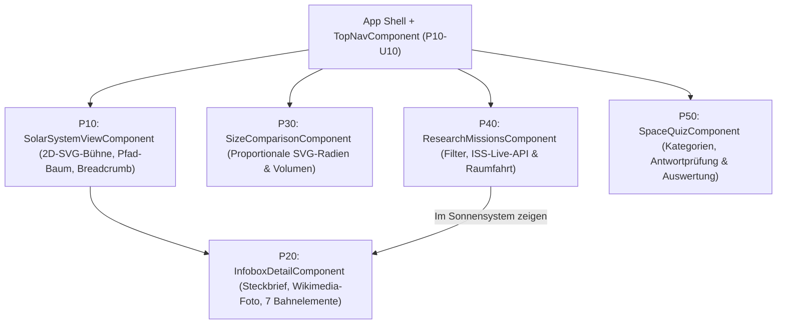

# SSI App --- Solar System Info APP

Interaktive, kindgerechte Single-Page-Application (SPA) mit **Angular 22** zur Erkundung unseres Sonnensystems, der 7 astronomischen Bahnelemente, maßstabsgetreuer Größenvergleiche, großer Raumfahrtmissionen und eines Weltraum-Quiz.

Entwickelt als Abschlussprojekt im **Modul Angular** (`BITLC NE5 FIAE WS26` – Fachinformatiker für Anwendungsentwicklung) bei der **BITLC GmbH Dortmund** (Dozent: Antonius Ehlen) nach dem **FCPP-Verfahren (Fast Compact Project Plan v1.5)**.

---

## Inhaltsverzeichnis

1. [Projekt-Überblick & FCPP-Architektur](#1-projekt-überblick--fcpp-architektur)
2. [Funktionsumfang nach FCPP-Elementen (`P10` bis `P50`)](#2-funktionsumfang-nach-fcpp-elementen-p10-bis-p50)
3. [Technischer Stack & Besonderheiten](#3-technischer-stack--besonderheiten)
4. [Installation, Entwicklung & Tests](#4-installation-entwicklung--tests)
5. [KI-Transparenz & Kennzeichnung](#5-ki-transparenz--kennzeichnung)

---

## 1. Projekt-Überblick & FCPP-Architektur



---

## 2. Funktionsumfang nach FCPP-Elementen (`P10` bis `P50`)

- **`P10` – Startseite: Interaktives Sonnensystem & Pfad-Navigation (`P10-U10` bis `P10-U40`)**
  - Fixierte Hauptnavigation mit `withHashLocation()` (für GitHub Pages).
  - Rekursive Pfad-Seitenleiste (`PathSidebarComponent`) und Breadcrumb-Leiste (`BreadcrumbBarComponent`) für 50 Himmelskörper, Zwergplaneten, Monde, Gürtel und Raumsonden.
  - Interaktive 2D-SVG-Bühne mit **stufenlosem logarithmischem Zoom (`0 %` bis `100 %` Slider, Mausrad & Buttons)**, analytischem SVG-Orbit-Clipping (für flüssige 60 FPS selbst bei tiefem Nahzoom auf die `408 km` ISS-Bahn oder gelandete Oberflächen-Missionen wie *Apollo* auf dem Erdmond und *Perseverance* auf dem Mars) sowie Echtzeit-Kepler-Positionen (`J2000`) inkl. Zeitraffer.
  - Umschalter zwischen **Übersicht**, **Echtem Maßstab (AE & Ellipsen)** und **Seitenansicht (Bahnneigung `INC` zum Sonnenäquator)**.
- **`P20` – Infobox / Detailansicht: Himmelskörper & 7 Bahnelemente (`P20-U10` bis `P20-U40`)**
  - Echte Weltraumfotos von **Wikimedia Commons** (NASA/ESA) mit automatischem lokalem SVG-Fallback (`assets/images/*.svg`) für 100 % Offline-Funktionalität.
  - Kindgerechte Beschreibungen, Entfernungen (Sonne/Erde), Umlaufdauer, Direktwahl der zugehörigen Monde/Raumsonden sowie ausklappbare **Astronomen-Box mit allen 7 Bahnelementen (`SMA`, `ECC`, `INC`, `LAN`, `LPE`, `MNA`, `REF`)**.
- **`P30` – Maßstabs- & Größenvergleich (`P30-U10`, `P30-U20`)**
  - Vergleich von 2 bis 5 Himmelskörpern über Dropdowns oder Schnellwahl-Presets.
  - Proportionale SVG-Vergleichsbühne mit automatischer Berechnung des Durchmesser- ($D_1 / D_2$) und Volumenverhältnisses ($(D_1 / D_2)^3$).
- **`P40` – Forschungsprojekte & Raumfahrt (`P40-U10`, `P40-U20`)**
  - Filterbare Übersicht und Detailsteckbriefe zu 10 großen Missionen (*Parker Solar Probe & Solar Orbiter*, *BepiColombo*, *Mars-Rover Perseverance & Curiosity*, *James-Webb-Teleskop*, *Gaia*, *Raumstation ISS*, *Apollo & Artemis*, *Juno & JUICE*, *Cassini-Huygens*, *Voyager 1 & 2*).
  - Live-Telemetrie der **ISS** über `https://api.wheretheiss.at/v1/satellites/25544` mit lokalem JSON-Fallback (`assets/data/iss-fallback.json`), Wikipedia-Link und Sprung-Button ins Sonnensystem (`--> P20`).
- **`P50` – Weltraum-Quiz & Auswertung (`P50-U10` bis `P50-U30`)**
  - Linkes Auswahlmenü für *Quiz des Tages*, *Missionsquiz* und *Raumkörperquiz*.
  - Multiple-Choice-Fragen (`A`–`D`), farbliche Antwortprüfung mit kindgerechter Erklärung und motivierende Endauswertung.

---

## 3. Technischer Stack & Besonderheiten

- **Framework:** Angular `22.2.7` (`@angular/cli@22.2.7`), TypeScript `~6.0`, Standalone Components, Signals (`signal`, `computed`, `effect`, `untracked`).
- **Design-Regel für die Projektdokumentation:** Weltraum-Hintergrund in tiefem Marine-/Nachtblau (`#0B132B` / `#111D3B` – kein `#000000`) kombiniert mit hellen, kontraststarken UI-Karten (`1px` Rahmen, dezente Radien), sodass sämtliche Screenshots für die IHK-Projektdokumentation prüfungskonform und drucksicher sind.
- **Unit-Tests:** Vitest 5 (`7` Test-Dateien, `12` Unit-Tests).

---

## 4. Installation, Entwicklung, Tests & GitHub Pages Deployment

```bash
# Abhängigkeiten installieren
npm install

# Entwicklungsserver starten (http://localhost:4200/)
npm start

# Production-Build erstellen (dist/ssi-app)
npm run build

# Build speziell für GitHub Pages (mit relativem Base-Href)
npx ng build --base-href ./

# Unit-Tests (Vitest) einmalig ausführen
npx ng test --watch=false
```

> **Hinweis für GitHub Pages:** Die Anwendung nutzt `withHashLocation()` in `src/app/app.config.ts`, `<base href="./" />` in `src/index.html` sowie ausschließlich relative Asset-Pfade (`assets/data/...` und `assets/images/...`). Dadurch lässt sich der Inhalt von `dist/ssi-app/browser` direkt auf GitHub Pages bereitstellen, ohne dass Routen oder Bilder bei einem Reload brechen.

---

## 5. KI-Transparenz & Kennzeichnung

Gemäß Aufgabenstellung ist jegliche KI-Unterstützung in Programmierung und Dokumentation ausgewiesen:

- Alle Quellcodedateien enthalten einen strukturierten Datei-Header mit Modulname, `FCPP`-Referenz und Angabe des KI-Umfangs.
- Das fortlaufende Sitzungsprotokoll befindet sich in [`AI-LOG.md`](./AI-LOG.md).
