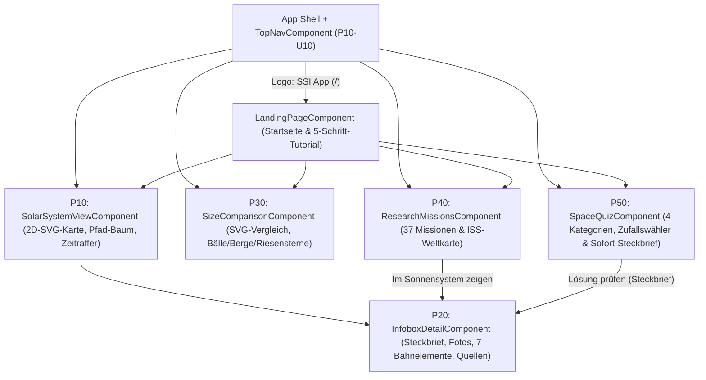

# SSI App --- Solar System Info APP

> **Live-Demo (GitHub Pages):** **[https://j-moessmer.github.io/BITLC-Angular-Solarsystem-Finalproject/](https://j-moessmer.github.io/BITLC-Angular-Solarsystem-Finalproject/)**

Interaktive, kindgerechte Single-Page-Application (SPA) mit **Angular 22** zur spielerischen Erkundung unseres Sonnensystems, der 7 astronomischen Bahnelemente, maßstabsgetreuer Größenvergleiche, großer Raumfahrtmissionen und eines Weltraum-Quiz.

Entwickelt als Abschlussprojekt im **Modul Angular** (`BITLC NE5 FIAE WS26` – Fachinformatiker für Anwendungsentwicklung) bei der **BITLC GmbH Dortmund** (Dozent: Antonius Ehlen) nach dem **FCPP-Verfahren (Fast Compact Project Plan v1.5)**.

---

## Inhaltsverzeichnis

1. [Projekt-Überblick & FCPP-Architektur](#1-projekt-überblick--fcpp-architektur)
2. [Funktionsumfang nach Modulen (`P10` bis `P50`)](#2-funktionsumfang-nach-modulen-p10-bis-p50)
3. [Technischer Stack & Besonderheiten](#3-technischer-stack--besonderheiten)
4. [Installation, Entwicklung, Tests & GitHub Pages Deployment](#4-installation-entwicklung-tests--github-pages-deployment)
5. [KI-Transparenz & Kennzeichnung](#5-ki-transparenz--kennzeichnung)

---

## 1. Projekt-Überblick & FCPP-Architektur



---

## 2. Funktionsumfang nach Modulen (`P10` bis `P50`)

- **Startseite & Entdecker-Tutorial (`LandingPageComponent`, Route `/`)**
  - Aufruf über den Brand-Link **„SSI App“** oben links oder beim Start der App.
  - Kindgerechte Hero-Begrüßung, **interaktives 5-Schritt-Entdecker-Tutorial** mit Direktlinks in alle Bereiche, Schnellstart-Karten und Projekt-/Quellen-Fußzeile.
- **`P10` – Interaktives Sonnensystem & Pfad-Navigation (`P10-U10` bis `P10-U40`)**
  - Fixierte Hauptnavigation (`TopNavComponent`) mit **Tag-/Nachtmodus-Umschalter** (`ThemeService` ohne `#000000`) und Hash-Routing (`withHashLocation()`).
  - Rekursive Pfad-Seitenleiste (`PathSidebarComponent`) und Breadcrumb-Leiste (`BreadcrumbBarComponent`) für **116 Einträge** (Sonne, 8 Planeten, 19 Monde, 5 Zwergplaneten, 3 Kometen, 2 Gürtel, 38 Raumsonden/Rover/Missionen und **40 Lagrange-Punkte `L1`–`L5` für alle 8 Planeten**).
  - Interaktive **2D-SVG-Bühne** mit **stufenlosem logarithmischem Zoom (`0 %`–`100 %`, `0.08x`–`36.000x`**, Mausrad-cursorzentriert & Vollbildmodus), analytischem SVG-Orbit-Clipping, Echtzeit-Kepler-Positionen (`J2000`, inkl. retrograder Bahnen für *1P/Halley* und *Triton*), Datums-Zeitreise (`1950`–`2100`), historischem Sonden-Filter und **adaptiver, aliasing-freier 30-FPS-Zeitraffer-Steuerung** für alle Mondsysteme.
  - Umschalter zwischen **Übersicht**, **Echtem Maßstab (AE & Ellipsen)** und **Seitenansicht (`INC`)** sowie **3-Stufen-Lagrange-Filter** (*Fokus (Planet) / Alle (40) / Aus*) mit kalibriertem `L1`/`L2`-Abstand außerhalb der Mondbahnen.
- **`P20` – Infobox / Detailansicht (`P20-U10` bis `P20-U40`)**
  - Verifizierte Wikimedia-/NASA-Fotos mit Foto-Galerie, **Originalgröße-Lightbox (`ImageLightboxComponent`)** und automatischem lokalem Fallback auf **11 Kategorie-SVGs (`assets/images/*.svg`)**.
  - Kindgerechte Steckbriefe, berechnete Bahngeschwindigkeit (`km/h` & `km/s`), anklickbare Mond-/Sonden-/Lagrange-Chips, **Fachbegriff-Tooltips (`GlossaryTermComponent`)**, responsive **7-Bahnelemente-Box (`SMA`, `ECC`, `INC`, `LAN`, `LPE`, `MNA`, `REF`)** sowie **Wikipedia- und offizielle NASA-/ESA-Quellenlinks (`wikipediaUrl`, `officialUrl`)** für alle 116 Einträge.
- **`P30` – Maßstabs- & Größenvergleich (`P30-U10`, `P30-U20`)**
  - Vergleich von 2 bis 5 Objekten über **gruppierte Dropdowns** und Schnellwahl-Presets.
  - Zusätzlich zu allen Körpern des Sonnensystems stehen **19 Vergleichsobjekte** (`extra-comparison-bodies.data.ts`) bereit – von Alltagsmaßen (**Fußball 22 cm**, **Basketball 24 cm**, **1-Meter-Kugel**), maßstabsgetreuen **SVG-Silhouetten** (**Mount Everest 9 km Höhe**, **Deutschland 876 km Nord–Süd**), Exoplaneten (*TRAPPIST-1 e*, *55 Cancri e*, *HD 189733 b*) bis zu Neutronenstern, *Sagittarius A\** und Riesensternen (*Beteigeuze*, *Stephenson 2-18*).
  - Sub-Meter-Tiefenzoom mit Horizont-Staffelung, automatische `cm`/`m`/`km`-Einheitenformatierung (`formatDiameter`, `formatBodyDimension`), Durchmesser- ($D_1 / D_2$) und Volumenverhältnis ($(D_1 / D_2)^3$) sowie Kurzinfos mit Wikipedia-Quellen.
- **`P40` – Forschungsprojekte & Raumfahrt (`P40-U10`, `P40-U20`)**
  - Filterbare Kartenübersicht und Detailsteckbriefe zu **37 internationalen Missionen** (NASA, ESA, Sowjetunion/Roskosmos, CNSA, JAXA, ISRO – inkl. *Apollo 11–17*, *Mars-Rovern*, *JWST*, *Gaia*, *ISS*, *Tiangong*, *Chang'e 4*, *Hayabusa2* und *Chandrayaan-3*).
  - Live-Telemetrie der **ISS** (`https://api.wheretheiss.at/v1/satellites/25544`, 5s-Auto-Polling & lokaler JSON-Fallback `assets/data/iss-fallback.json`) inkl. **2D-Weltkarte (`IssWorldMapComponent`)** mit Tag-/Nacht-Schatten und Bahnspur, doppelte Quellenbuttons (`officialUrl` + `wikipediaUrl`) und Sprung direkt ins Sonnensystem (`--> P20`).
- **`P50` – Weltraum-Quiz & Auswertung (`P50-U10` bis `P50-U30`)**
  - **36 Fragen in 4 Kategorien** (*Quiz des Tages* mit **Fisher-Yates-Zufallswähler „Fragen neu würfeln“**, *Planeten & Monde*, *Raumfahrt & Missionen*, *Bahnen, Kometen & Rekorde*).
  - Multiple-Choice-Fragen (`A`–`D`), farbliche Antwortprüfung, kindgerechte Erklärung, **direkt eingebetteter Bild-Steckbrief (`InfoboxDetailComponent`)** nach Klick auf *„Lösung prüfen“* sowie motivierende Endauswertung im hellen und dunklen Design.

---

## 3. Technischer Stack & Besonderheiten

- **Framework:** Angular `22.2.0` (`@angular/cli` `22.2.7`), TypeScript `~6.0.2`, Standalone Components, Angular Signals (`signal`, `computed`, `effect`, `untracked`), `@angular/router` (`withHashLocation()`, `withComponentInputBinding()`).
- **Icons & Visualisierung:** `@fortawesome/fontawesome-free` `7.3.1`, interaktive 2D-SVGs mit analytischem Orbit-Clipping.
- **Design-Regel für die Projektdokumentation:** Weltraum-Hintergrund in tiefem Marine-/Nachtblau (`#0B132B` / `#111D3B` – kein `#000000`) kombiniert mit Tag-/Nachtmodus (`ThemeService`) und kontraststarken UI-Karten für prüfungskonforme Screenshots ohne schwarze Bilder.
- **Unit-Tests:** Vitest `5` (`7` Test-Dateien, `16` Unit-Tests).

---

## 4. Installation, Entwicklung, Tests & GitHub Pages Deployment

```bash
# Abhängigkeiten installieren
npm install

# Entwicklungsserver starten (http://localhost:4200/)
npm start

# Production-Build erstellen (dist/ssi-app)
npm run build

# Build speziell für GitHub Pages (mit relativem Base-Href)
npm run build:gh-pages

# Unit-Tests (Vitest) einmalig ausführen
npm test -- --watch=false
```

> **Hinweis für GitHub Pages:** Die Anwendung nutzt `withHashLocation()` in `src/app/app.config.ts`, `<base href="./" />` in `src/index.html` sowie ausschließlich relative Asset-Pfade (`assets/data/...` und `assets/images/...`). Die Bereitstellung erfolgt automatisch über `.github/workflows/deploy-pages.yml` aus `dist/ssi-app/browser`.

---

## 5. KI-Transparenz & Kennzeichnung

Gemäß Aufgabenstellung ist jegliche KI-Unterstützung in Programmierung und Dokumentation ausgewiesen:

- Alle Quellcodedateien enthalten einen strukturierten Datei-Header mit Modulname, `FCPP`-Referenz und Angabe des KI-Umfangs.
- Das fortlaufende Sitzungsprotokoll befindet sich in [`AI-LOG.md`](./AI-LOG.md).
