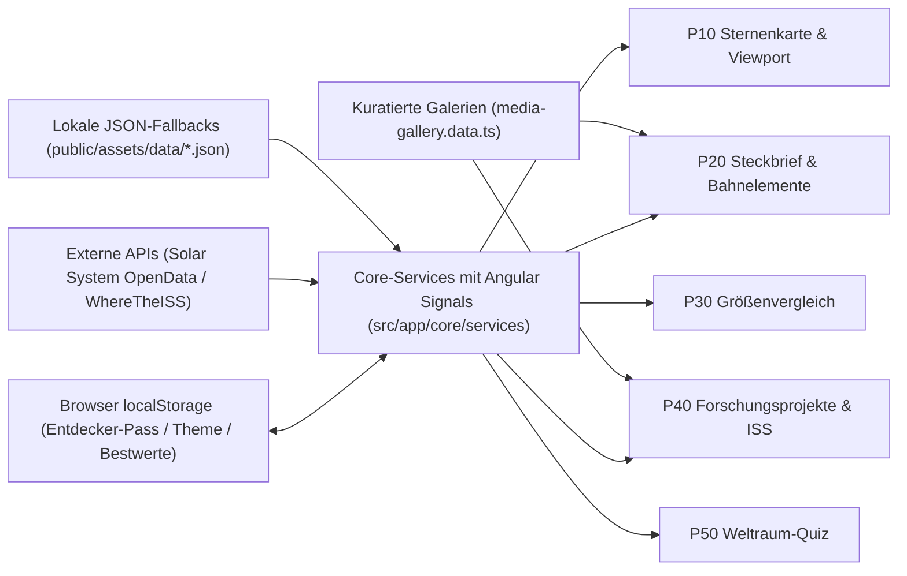
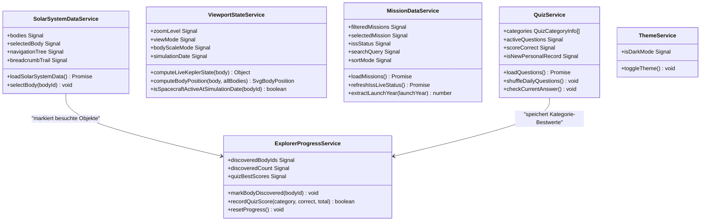

# Core-Modul (`src/app/core`)

Zurück zur [Haupt-Übersicht](../../../README.md).

Das Core-Modul bildet das zentrale Daten-, Zustands- und Berechnungsfundament der **SSI App** (FCPP-Elemente `P10` bis `P50`). Es kapselt alle TypeScript-Datenmodelle, sechs `Signal`-basierte Services, kuratierte Bildergalerien sowie offline-fähige API-Fallback- und `localStorage`-Mechanismen.

## Inhaltsverzeichnis

1. [Architektur und Datenfluss](#1-architektur-und-datenfluss)
2. [Service-Struktur als Klassendiagramm](#2-service-struktur-als-klassendiagramm)
3. [Dateiübersicht](#3-dateiübersicht)
4. [Übersicht aller Datenquellen](#4-übersicht-aller-datenquellen)
5. [Technische Detailerklärungen und Codebeispiele](#5-technische-detailerklärungen-und-codebeispiele)
   - [5.1 Typsichere Datenmodelle und 7 Bahnelemente](#51-typsichere-datenmodelle-und-7-bahnelemente)
   - [5.2 Offline-First-Datenversorgung und API-Anreicherung](#52-offline-first-datenversorgung-und-api-anreicherung)
   - [5.3 Echtzeit-Kepler-Solver (J2000) und elliptische Satellitenbahnen](#53-echtzeit-kepler-solver-j2000-und-elliptische-satellitenbahnen)
   - [5.4 Robuste localStorage-Persistenz im Entdecker-Pass](#54-robuste-localstorage-persistenz-im-entdecker-pass)
   - [5.5 Deduplizierte Fotogalerie-Kaskade](#55-deduplizierte-fotogalerie-kaskade)
6. [Tests und Verifizierung](#6-tests-und-verifizierung)
7. [KI-Transparenz](#7-ki-transparenz)

## 1. Architektur und Datenfluss



## 2. Service-Struktur als Klassendiagramm



## 3. Dateiübersicht

| Pfad | Aufgabe | FCPP-Bezug |
| :--- | :--- | :--- |
| [`models/celestial-body.model.ts`](./models/celestial-body.model.ts) | Interfaces `CelestialBody`, `OrbitalElements` (`SMA`–`REF` inkl. `AOP`), `OrbitalElementDetail` | `P10`, `P20`, `P30` |
| [`models/research-mission.model.ts`](./models/research-mission.model.ts) | Interfaces `ResearchMission`, `MissionCategory` (inkl. Multi-Kategorie `categories`), `IssLiveStatus` | `P40` |
| [`models/quiz.model.ts`](./models/quiz.model.ts) | Typen `QuizCategoryId`, `QuizCategoryInfo`, `QuizQuestion` | `P50` |
| [`services/solar-system-data.service.ts`](./services/solar-system-data.service.ts) | Lädt `118` Katalogeinträge (API + JSON-Fallback), erzeugt `navigationTree` und `breadcrumbTrail` | `P10-U20`, `P20-U20..U30`, `P30-U20` |
| [`services/viewport-state.service.ts`](./services/viewport-state.service.ts) | Echtzeit-Kepler-Solver (`J2000`), gedrehte Ellipsen für Planeten/Kometen/Satelliten, Orbit-Clipping, `40` Lagrange-Punkte, Zoom (`0.08x`–`36.000x`), Zeitreise (`1950`–`2100`) | `P10-U20..U40`, `P20-U20..U40` |
| [`services/mission-data.service.ts`](./services/mission-data.service.ts) | Lädt `50` Missionen, Filterung, Textsuche, Zeitstrahl (`1957` bis heute) und ISS-Live-Telemetrie mit Fallback | `P40-U10`, `P40-U20` |
| [`services/quiz.service.ts`](./services/quiz.service.ts) | Steuert `42` Fragen in `4` Kategorien, Fisher-Yates-Zufallswähler (*Quiz des Tages*) und kindgerechte Auswertung | `P50-U10..U30` |
| [`services/explorer-progress.service.ts`](./services/explorer-progress.service.ts) | Offline-fähige `localStorage`-Persistenz für entdeckte Körper (`X / 118`) und Quiz-Bestwerte | `P10-U20`, `P20-U10`, `P50-U20..U30` |
| [`services/theme.service.ts`](./services/theme.service.ts) | Signal-Steuerung für Tag-/Nachtmodus (Marineblau `#0B132B` / `#111D3B` ohne `#000000`) | Übergreifendes UI |
| [`data/media-gallery.data.ts`](./data/media-gallery.data.ts) | Kuratierte, HTTP-200-geprüfte Fotogalerien (`buildBodyGallery`, `buildMissionGallery` mit mindestens `5` Fotos) | `P20-U10..U20`, `P40-U20`, `P50-U20` |
| [`services/core-services.spec.ts`](./services/core-services.spec.ts) | Unit-Test-Suite für alle Core-Services | `P10`–`P50` |

## 4. Übersicht aller Datenquellen

Alle Module der Anwendung beziehen ihre Daten zentral über die Services und Datendateien des Core-Moduls:

| Typ | Konkrete Quelle | Genutzt in Modul | Aufgabe und Offline-Verhalten |
| :--- | :--- | :--- | :--- |
| **Lokales JSON-Asset** | [`solar-system-fallback.json`](../../../public/assets/data/solar-system-fallback.json) | `P10`, `P20`, `P30`, `P50` | Primärer Katalog für `118` Objekte inkl. `7`+ Bahnelementen, Texten & Links |
| **Lokales JSON-Asset** | [`missions.json`](../../../public/assets/data/missions.json) | `P20`, `P40` | `50` internationale Raumfahrtmissionen inkl. Multi-Kategorien |
| **Lokales JSON-Asset** | [`iss-fallback.json`](../../../public/assets/data/iss-fallback.json) | `P40` | Offline-Telemetrie-Fallback für die ISS-Position & Weltkarte |
| **Lokales JSON-Asset** | [`quiz-questions.json`](../../../public/assets/data/quiz-questions.json) | `P50` | `42` Quizfragen in `4` Kategorien mit `relatedBodyId` |
| **Externe Live-API** | `https://api.le-systeme-solaire.net/rest/bodies` | `P10`, `P20`, `P30` | Optionale Live-Durchmesser (`timeout(2500)`); Fallback auf lokales JSON |
| **Externe Live-API** | `https://api.wheretheiss.at/v1/satellites/25544` | `P40` | Live-Telemetrie der ISS (`timeout(2500)`, 5s-Polling); Fallback auf `iss-fallback.json` |
| **Statische Medien- & Zusatzdaten** | [`media-gallery.data.ts`](./data/media-gallery.data.ts) & `public/assets/images/` | `P10`, `P20`, `P40` | Kuratierte Wikimedia-/NASA-URLs (`5`–`6` Fotos je Eintrag) + `11` lokale Kategorie-SVGs |
| **Browser-`localStorage`** | `ssi_app_discovered_bodies_v1`, `ssi_app_quiz_best_scores_v1`, `ssi-app-theme` | `Shared`, `P10`, `P20`, `P50` | Lokaler Entdecker-Pass (`X / 118`), Quiz-Bestwerte pro Kategorie und Tag-/Nachtmodus |

## 5. Technische Detailerklärungen und Codebeispiele

### 5.1 Typsichere Datenmodelle und 7 Bahnelemente

Alle `118` Objekte in `public/assets/data/solar-system-fallback.json` teilen sich eine einheitliche TypeScript-Struktur in [`models/celestial-body.model.ts`](./models/celestial-body.model.ts). Dadurch können `P10` (Sternenkarte), `P20` (Steckbrief) und `P30` (Größenvergleich) Planeten, Monde, Kometen, Gürtel, `40` Lagrange-Punkte und Raumsonden polymorph über dieselben Pipelines verarbeiten:

- **Duale Bildversorgung:** Jeder Datensatz trennt zwischen der externen Foto-URL (`wikimediaImageUrl`) und einem relativen Offline-Asset (`imageUrl` unter `assets/images/...`), damit bei `--base-href` auf GitHub Pages oder im Offline-Betrieb kein Bildpfad bricht.
- **Oberflächen-Flag (`isSurfaceLanded`):** Gelandete Missionen wie *Apollo 11–17* auf dem Mond oder *Perseverance/Curiosity* auf dem Mars setzen `isSurfaceLanded: true`, sodass `ViewportStateService` sie direkt auf der Planetenoberfläche verankert statt ihnen eine Umlaufbahn zuzuweisen.
- **Astronomische Bahnelemente (`OrbitalElements`):** Kapselt neben den 7 Pflichtelementen (`SMA`, `ECC`, `INC`, `LAN`, `LPE`, `MNA`, `REF`) optional auch das Argument der Periapsis (`AOP` / $\omega$) inklusive `numericValue` für die Live-Mathematik und `childExplanation` für die kindgerechte Anzeige.

```typescript
// Ausschnitt aus src/app/core/models/celestial-body.model.ts
export type BodyCategory =
  | 'star'
  | 'planet'
  | 'dwarf-planet'
  | 'moon'
  | 'comet'
  | 'belt'
  | 'spacecraft'
  | 'lagrange';

export interface OrbitalElementDetail {
  code: 'SMA' | 'ECC' | 'INC' | 'LAN' | 'AOP' | 'LPE' | 'MNA' | 'REF';
  label: string;
  formattedValue: string;
  numericValue?: number;
  unit?: string;
  childExplanation: string;
}

export interface CelestialBody {
  id: string;
  name: string;
  englishApiId?: string;
  subtitle: string;
  category: BodyCategory;
  categoryLabel: string;
  parentId?: string;
  isSurfaceLanded?: boolean;
  childrenIds: string[];
  wikimediaImageUrl: string;
  imageUrl: string;
  diameterKm: number;
  distanceFromSunAu: number;
  distanceFromEarthKm: number;
  orbitalPeriodDays: number;
  inclinationToSolarEquatorDeg: number;
  overviewOrbitRadiusSvg: number;
  overviewBodyRadiusSvg: number;
  orbitAngleDeg: number;
  officialUrl?: string;
  wikipediaUrl?: string;
  orbitalElements: OrbitalElements;
}
```

### 5.2 Offline-First-Datenversorgung und API-Anreicherung

[`SolarSystemDataService`](./services/solar-system-data.service.ts) verfolgt konsequent ein **Offline-First-Muster**: Statt beim App-Start auf eine externe Astronomie-API zu warten (die im Prüfungsnetz oder bei CORS-Blockaden ausfallen könnte), wird immer zuerst die lokale JSON-Datei `assets/data/solar-system-fallback.json` geladen und sofort in das private Signal `bodiesState` geschrieben (`usingFallbackState` auf `true`).

Erst danach versucht `loadSolarSystemData()`, die Solar-System-OpenData-API abzurufen. Ein striktes `timeout(2500)` mit `catchError(() => of(null))` verhindert Hänger. Liefert die API gültige Daten, werden nur die Durchmesser (`meanRadius * 2`) über `englishApiId` aktualisiert, sodass alle kindgerechten Texte, Bahnelemente und Wikimedia-Fotos unverändert erhalten bleiben. Zusätzlich markiert `selectBody(bodyId)` jedes angeklickte Objekt sofort im `ExplorerProgressService`.

```typescript
// Ausschnitt aus src/app/core/services/solar-system-data.service.ts (Zeilen 287–347)
async loadSolarSystemData(): Promise<CelestialBody[]> {
  if (this.bodiesState().length > 0) {
    return this.bodiesState();
  }

  this.loadingState.set(true);
  try {
    const localBodies = await firstValueFrom(
      this.http
        .get<CelestialBody[]>(this.localFallbackUrl)
        .pipe(catchError(() => of([] as CelestialBody[]))),
    );

    this.bodiesState.set(localBodies);
    this.usingFallbackState.set(true);

    const apiData = await firstValueFrom(
      this.http.get<OpenSolarSystemApiResponse>(this.externalApiUrl).pipe(
        timeout(2500),
        catchError(() => of(null)),
      ),
    );

    if (apiData?.bodies && apiData.bodies.length > 0) {
      const apiMap = new Map(
        apiData.bodies
          .filter((b): b is Required<Pick<typeof b, 'id'>> & typeof b => Boolean(b.id))
          .map((b) => [b.id, b]),
      );

      const merged = localBodies.map((body) => {
        const live = body.englishApiId ? apiMap.get(body.englishApiId) : undefined;
        if (!live) {
          return body;
        }
        return {
          ...body,
          diameterKm:
            live.meanRadius && live.meanRadius > 0
              ? Math.round(live.meanRadius * 2)
              : body.diameterKm,
        };
      });

      this.bodiesState.set(merged);
      this.usingFallbackState.set(false);
    }

    return this.bodiesState();
  } finally {
    this.loadingState.set(false);
  }
}

selectBody(bodyId: string | null): void {
  this.selectedBodyIdState.set(bodyId);
  if (bodyId) {
    this.explorerProgress.markBodyDiscovered(bodyId);
  }
}
```

### 5.3 Echtzeit-Kepler-Solver (J2000) und elliptische Satellitenbahnen

In [`ViewportStateService`](./services/viewport-state.service.ts) berechnet `computeLiveKeplerState(body)` aus der Differenz seit der Standardepoche `J2000.0` (`daysSinceJ2000`) die reale Position entlang einer Kepler-Ellipse:

1. **Mittlere Anomalie $M$:** Aus Startanomalie $M_0$ (`mna`), Umlaufdauer $T$ (`orbitalPeriodDays`) und verstrichenen Tagen ergibt sich die mittlere Bewegung $n = 360^\circ / T$.
2. **Kepler-Gleichung $M = E - e \sin E$:** Da diese transzendente Gleichung nicht geschlossen nach der exzentrischen Anomalie $E$ auflösbar ist, läuft ein **Newton-Raphson-Verfahren** mit bis zu `15` Iterationen (`|deltaE| < 1e-9`). Für stark exzentrische Kometenbahnen mit $e > 0{,}85$ (bis max. `0.9995`, z. B. *1P/Halley*, *Hale-Bopp*, *NEOWISE*) verhindert ein kubischer Startwert $\sqrt[3]{6M / e}$ Divergenzen nahe dem Perihel.
3. **Wahre Anomalie $\nu$ und Abstand $r$:** Aus $E$ entstehen über `Math.atan2` die wahre Anomalie $\nu$, der momentane Sonnenabstand $r = a(1 - e \cos E)$ in AE sowie die heliozentrische Länge $\lambda = (\nu + \varpi) \bmod 360^\circ$.

```typescript
// Ausschnitt aus src/app/core/services/viewport-state.service.ts (Zeilen 430–469)
const m0Deg = body.orbitalElements.mna.numericValue ?? body.orbitAngleDeg;
const lpeDeg = body.orbitalElements.lpe.numericValue ?? 0;
const ecc = Math.min(0.9995, Math.max(0, body.orbitalElements.ecc.numericValue ?? 0));
const smaAu = body.orbitalElements.sma.numericValue ?? body.distanceFromSunAu;

const meanMotionDegPerDay = 360.0 / body.orbitalPeriodDays;
const currentMeanAnomalyDeg = (((m0Deg + meanMotionDegPerDay * days) % 360) + 360) % 360;
const M = (currentMeanAnomalyDeg * Math.PI) / 180;

let E =
  ecc > 0.85
    ? M < Math.PI
      ? Math.min(Math.PI, Math.max(M, Math.cbrt((6 * M) / ecc)))
      : Math.max(Math.PI, 2 * Math.PI - Math.cbrt((6 * (2 * Math.PI - M)) / ecc))
    : M + ecc * Math.sin(M);
for (let i = 0; i < 15; i++) {
  const f = E - ecc * Math.sin(E) - M;
  const fp = Math.max(1e-7, 1 - ecc * Math.cos(E));
  const deltaE = f / fp;
  E -= deltaE;
  if (Math.abs(deltaE) < 1e-9) {
    break;
  }
}

const sinHalfE = Math.sin(E / 2);
const cosHalfE = Math.cos(E / 2);
const nu =
  2 * Math.atan2(Math.sqrt(1 + ecc) * sinHalfE, Math.sqrt(1 - ecc) * cosHalfE);

const rAu = Number((smaAu * (1 - ecc * Math.cos(E))).toFixed(3));
const nuDeg = (nu * 180) / Math.PI;
const longitudeDeg = Number(((((nuDeg + lpeDeg) % 360) + 360) % 360).toFixed(1));
```

Für Monde und planetare Satelliten (wie **Vanguard 1** mit $e = 0{,}185$ um die Erde, *Juno* um Jupiter oder retrograde Monde wie *Triton*) berechnet `computeBodyPosition()` in [`viewport-state.service.ts`](./services/viewport-state.service.ts) ebenfalls eine **echte gedrehte Ellipse** mit Perigäums-Schutzabstand (`minPeriapsisPx = parentPos.bodyRadiusPx + 3.5`), damit die Bahnellipse niemals optisch in den Mutterplaneten schneidet:

```typescript
// Ausschnitt aus src/app/core/services/viewport-state.service.ts (Zeilen 884–912)
const rawSatEcc = body.id === 'apollo-13' ? 0 : (body.orbitalElements.ecc.numericValue ?? 0);
let satEcc = Math.min(0.85, Math.max(0, rawSatEcc));
const minPeriapsisPx = parentPos.bodyRadiusPx + 3.5;
if (satEcc > 0 && screenOrbitRx * (1 - satEcc) < minPeriapsisPx) {
  if (satEcc <= 0.6) {
    screenOrbitRx = Number((minPeriapsisPx / (1 - satEcc)).toFixed(1));
  } else {
    satEcc = Math.max(0.15, Number((1 - minPeriapsisPx / screenOrbitRx).toFixed(4)));
  }
}

const screenOrbitRy = Number((screenOrbitRx * Math.sqrt(1 - satEcc * satEcc)).toFixed(1));
const focalOffsetPx = Number((-screenOrbitRx * satEcc).toFixed(2));
const satPeriapsisDeg = satEcc > 0 ? this.getPerihelionOrientationDeg(body) : 0;
const satPeriapsisRad = (-satPeriapsisDeg * Math.PI) / 180;
const satOrbitRotationDeg = Number((-satPeriapsisDeg).toFixed(2));
const cosSatPhi = Math.cos(satPeriapsisRad);
const sinSatPhi = Math.sin(satPeriapsisRad);
const satOrbitCenterX = Number((parentPos.x + focalOffsetPx * cosSatPhi).toFixed(1));
const satOrbitCenterY = Number((parentPos.y + focalOffsetPx * sinSatPhi).toFixed(1));

const orbitAngleRad = isRetrogradeMoon
  ? kepler.eccentricAnomalyRad
  : -kepler.eccentricAnomalyRad;
const localX = focalOffsetPx + Math.cos(orbitAngleRad) * screenOrbitRx;
const localY = Math.sin(orbitAngleRad) * screenOrbitRy;
const offsetScreenX = localX * cosSatPhi - localY * sinSatPhi;
const offsetScreenY = localX * sinSatPhi + localY * cosSatPhi;
```

### 5.4 Robuste localStorage-Persistenz im Entdecker-Pass

[`ExplorerProgressService`](./services/explorer-progress.service.ts) setzt die komplette Persistenz des **Entdecker-Passes** (`X / 118 entdeckt`) sowie der persönlichen **Quiz-Bestwerte** rein clientseitig im Browser-`localStorage` um – ohne Backend, Benutzerkonto oder Server-Sync. Die Daten überleben Seiten-Neuladen und App-Neustarts, bleiben aber ausschließlich lokal auf dem verwendeten Gerät gespeichert (löschbar über Browser-Website-Daten oder `resetProgress()`).

**1. Gespeicherte Schlüssel und JSON-Format im Browser-`localStorage`:**

- **`ssi_app_discovered_bodies_v1`:** JSON-Array der bereits besuchten `CelestialBody.id`-Strings (dedupliziert über ein `Set<string>`):

```json
["earth", "moon", "vanguard-1", "mars"]
```

- **`ssi_app_quiz_best_scores_v1`:** JSON-Objekt mit dem jeweils höchsten erreichten Ergebnis pro Quiz-Kategorie (`daily`, `missions`, `celestial`, `astronomy`):

```json
{
  "daily": { "correct": 6, "total": 7, "ratio": 0.8571428571428571 },
  "missions": { "correct": 12, "total": 12, "ratio": 1 }
}
```

**2. Modulübergreifender Schreib- und Lesefluss:**

- **Schreibzugriffe:** `SolarSystemDataService.selectBody()` (`P10`/`P20` bei jedem Klick in der Sternenkarte, im Pfad-Baum oder in der Infobox), `SpaceQuizComponent.onCheckAnswer()` / `onSelectSteckbriefBody()` (`P50` beim Prüfen einer Quiz-Antwort oder Öffnen eines Mond-Steckbriefs) sowie `QuizService.nextQuestion()` am Ende einer Quiz-Runde.
- **Lesezugriffe (reaktiv via Signals):** `PathSidebarComponent` zeigt den Fortschrittsbalken `X / 118 entdeckt` sowie grüne Entdeckt-Häkchen an den besuchten Baumknoten; `SpaceQuizComponent` rendert dieselben Daten als Entdecker-Pass-Karte und Kategorie-Rekorde.

**3. Fehlerabsicherung und Validierung beim Lesen/Schreiben:**

Beim Start initialisiert der Service seine privaten Signals über `loadDiscoveredBodies()` bzw. `loadQuizBestScores()`. Dabei werden fehlendes `localStorage` (z. B. SSR/Tests), beschädigtes JSON, ungültige Kategorien sowie nicht-endliche Zahlenwerte abgefangen. In `recordQuizScore()` entscheidet zuerst die höhere Quote `ratio` und bei identischer Quote die größere absolute Trefferzahl `safeCorrect`:

```typescript
// Ausschnitt aus src/app/core/services/explorer-progress.service.ts (Zeilen 45–88)
markBodyDiscovered(bodyId: string | null | undefined): void {
  const normalized = bodyId?.trim();
  if (!normalized || this.discoveredBodyIdSet().has(normalized)) {
    return;
  }
  const next = [...this.discoveredBodyIdsState(), normalized];
  this.discoveredBodyIdsState.set(next);
  this.saveToStorage(DISCOVERED_STORAGE_KEY, next);
}

recordQuizScore(category: QuizCategoryId, correct: number, total: number): boolean {
  const safeTotal = Math.max(1, total);
  const safeCorrect = Math.max(0, Math.min(correct, safeTotal));
  const ratio = safeCorrect / safeTotal;
  const prev = this.quizBestScoresState()[category];

  const shouldUpdate =
    !prev || ratio > prev.ratio || (ratio === prev.ratio && safeCorrect > prev.correct);

  if (!shouldUpdate) {
    return false;
  }

  const nextScores: Partial<Record<QuizCategoryId, QuizBestScore>> = {
    ...this.quizBestScoresState(),
    [category]: {
      correct: safeCorrect,
      total: safeTotal,
      ratio,
    },
  };
  this.quizBestScoresState.set(nextScores);
  this.saveToStorage(QUIZ_SCORES_STORAGE_KEY, nextScores);
  return safeCorrect > 0;
}
```

Beim Laden und Speichern schützen explizite Typprüfungen sowie `try/catch`-Blöcke vor Abstürzen im privaten Browser-Modus oder bei vollem Speicher-Quota (`loadDiscoveredBodies()` und `saveToStorage()`):

```typescript
// Ausschnitt aus src/app/core/services/explorer-progress.service.ts (Zeilen 108–136 & 183–191)
private loadDiscoveredBodies(): string[] {
  try {
    if (typeof localStorage === 'undefined') {
      return [];
    }
    const raw = localStorage.getItem(DISCOVERED_STORAGE_KEY);
    if (!raw) {
      return [];
    }
    const parsed: unknown = JSON.parse(raw);
    if (!Array.isArray(parsed)) {
      return [];
    }
    const seen = new Set<string>();
    const valid: string[] = [];
    for (const item of parsed) {
      if (typeof item === 'string') {
        const trimmed = item.trim();
        if (trimmed && !seen.has(trimmed)) {
          seen.add(trimmed);
          valid.push(trimmed);
        }
      }
    }
    return valid;
  } catch {
    return [];
  }
}

private saveToStorage(key: string, value: unknown): void {
  try {
    if (typeof localStorage !== 'undefined') {
      localStorage.setItem(key, JSON.stringify(value));
    }
  } catch {
    // Speicherzugriff im privaten Modus oder bei vollem Quota still ignorieren
  }
}
```

### 5.5 Deduplizierte Fotogalerie-Kaskade

[`data/media-gallery.data.ts`](./data/media-gallery.data.ts) stellt sicher, dass jedes der `118` Objekte in `P20` und jede der `50` Missionen in `P40` stets **mindestens `5` (bis zu `6`) einzigartige, verifizierte Fotos** ohne Duplikate erhält. Dazu nutzt `buildMissionGallery` (analog zu `buildBodyGallery`) ein `Set<string>` zur URL-Deduplizierung und füllt der Reihe nach aus Missionsbild, kuratierten Galerie-Einträgen, Zielkörper-Fotos und dem allgemeinen Raumfahrt-Pool auf:

```typescript
// Ausschnitt aus src/app/core/data/media-gallery.data.ts (Zeilen 1767–1794)
export function buildMissionGallery(mission: ResearchMission): GalleryMediaItem[] {
  const items: GalleryMediaItem[] = [];
  const seen = new Set<string>();
  const addItem = (url: string | undefined, caption: string): void => {
    if (!url || seen.has(url) || items.length >= 6) {
      return;
    }
    seen.add(url);
    items.push({ url, caption });
  };

  addItem(mission.wikimediaImageUrl || mission.imageUrl, mission.title);
  for (const extra of BODY_AND_MISSION_GALLERY[mission.id] ?? []) {
    addItem(extra.url, extra.caption);
  }
  for (const targetExtra of BODY_AND_MISSION_GALLERY[mission.targetBodyId] ?? []) {
    addItem(targetExtra.url, targetExtra.caption);
  }
  const fallbackPool =
    CATEGORY_FALLBACK_POOL['spacecraft'] ?? LAGRANGE_GALLERY_EXTRAS;
  for (const fallback of fallbackPool) {
    if (items.length >= 5) {
      break;
    }
    addItem(fallback.url, fallback.caption);
  }
  return items;
}
```

## 6. Tests und Verifizierung

Die Unit-Tests liegen in [`services/core-services.spec.ts`](./services/core-services.spec.ts) (`8` Tests) und prüfen:

- Zoom-, Pan-, ViewMode- und historische Startdatum-Filter (`vanguard-1` ab `1958-03-17`).
- Kollineare und `60°`-Lagrange-Geometrie (`L1`–`L5` für Erde, Jupiter und Merkur) sowie hoch-exzentrische Kometenbahnen (*NEOWISE* im Perihel `2020-07-03` vs. `2026-11-19`).
- Gedrehte elliptische Satellitenbahn um die Erde (*Vanguard 1* bei `1x` und `8000x` Zoom).
- Fallback-Laden von `SolarSystemDataService`, `MissionDataService` (ISS-Fallback, Textsuche, Zeitstrahl-Sortierung), `QuizService` und `ExplorerProgressService` (`localStorage`-Bestwerte).

## 7. KI-Transparenz

Alle Dateien dieses Moduls enthalten den verpflichtenden `AGENTS.md`-Datei-Header zur Kennzeichnung des KI-Einsatzes; die fortlaufende Dokumentation erfolgt im zentralen [`AI-LOG.md`](../../../AI-LOG.md).
