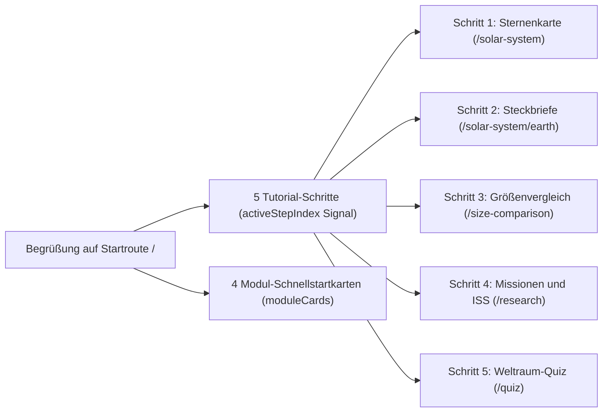

# Startseite und Entdecker-Tutorial (`src/app/features/landing-page`)

Zurück zur [Haupt-Übersicht](../../../../README.md).

Die **Landing Page** (`LandingPageComponent`, Startroute `/` sowie Wildcard-Fallback `'**'`) begrüßt Grundschulkinder ohne technische FCPP-Kürzel, erklärt die App in einem interaktiven **5-Schritt-Entdecker-Tutorial** und bietet Direktkarten in alle vier Hauptmodule (`P10`/`P20`, `P30`, `P40` und `P50`). Ein Klick auf das Logo **„SSI App“** in [`TopNavComponent`](../../shared/README.md) führt jederzeit hierher zurück.

## Inhaltsverzeichnis

1. [Ablauf des Entdecker-Tutorials](#1-ablauf-des-entdecker-tutorials)
2. [Dateistruktur](#2-dateistruktur)
3. [Kernfunktionen und Routing](#3-kernfunktionen-und-routing)
4. [Technische Detailerklärungen und Codebeispiele](#4-technische-detailerklärungen-und-codebeispiele)
   - [4.1 Deklaratives Tutorial-Modell und Signal-Zustandssteuerung](#41-deklaratives-tutorial-modell-und-signal-zustandssteuerung)
   - [4.2 Angular-22-Control-Flow und barrierearme Tab-Steuerung](#42-angular-22-control-flow-und-barrierearme-tab-steuerung)
   - [4.3 Eingebettete Marineblau-Illustration und Hash-Routing](#43-eingebettete-marineblau-illustration-und-hash-routing)
5. [Tests und Verifizierung](#5-tests-und-verifizierung)
6. [KI-Transparenz](#6-ki-transparenz)

## 1. Ablauf des Entdecker-Tutorials



## 2. Dateistruktur

| Datei | Aufgabe | FCPP-Bezug |
| :--- | :--- | :--- |
| [`landing-page.ts`](./landing-page.ts) | Standalone-Komponente mit `tutorialSteps`, `moduleCards`, `activeStepIndex` (`Signal`) und Methoden `selectStep`, `prevStep`, `nextStep` | Einstiegspunkt `P10`–`P50` |
| [`landing-page.html`](./landing-page.html) | Hero-Bereich, interaktiver 5-Schritt-Tab-Assistent (*Vor / Zurück* + Direktsprung), 4 Modul-Karten und dezente Projekt-/Quellen-Fußzeile | Einstiegspunkt `P10`–`P50` |
| [`landing-page.css`](./landing-page.css) | Tag-/Nachtmodus-kompatible Hero-, Tutorial- und Karten-Layouts mit `1px` Rahmen und ohne `#000000` | Übergreifendes UI |

## 3. Kernfunktionen und Routing

- **5-Schritt-Entdecker-Tutorial:** Kinder klicken sich über fünf nummerierte Tabs oder die Buttons *Zurück* / *Weiter* durch die Funktionen (Sternenkarte, Steckbriefe, Größenvergleich, Missionen, Quiz) und können jeden Bereich direkt aus dem Schritt heraus starten.
- **Modul-Übersicht und Fußzeile:** Vier Schnellstart-Karten verlinken über `RouterLink` direkt auf `/solar-system`, `/size-comparison`, `/research` und `/quiz`; die Fußzeile nennt Projektkontext (`BITLC NE5 FIAE WS26`) und Datenquellen.

## 4. Technische Detailerklärungen und Codebeispiele

### 4.1 Deklaratives Tutorial-Modell und Signal-Zustandssteuerung

[`LandingPageComponent`](./landing-page.ts) modelliert die `5` Tutorial-Schritte (`TutorialStep`) und `4` Schnellstart-Karten (`ModuleQuickCard`) vollständig deklarativ als schreibgeschützte Datenarrays. Ein einzelnes Writable-Signal `activeStepIndex` speichert den gewählten Schritt (`0` bis `4`), woraus das Computed-Signal `activeStep` immer exakt ein gültiges `TutorialStep`-Objekt ableitet. Die Navigationsmethoden `selectStep`, `prevStep` und `nextStep` schützen gegen Bereichsüberschreitungen per `Math.max` / `Math.min`:

```typescript
// Ausschnitt aus src/app/features/landing-page/landing-page.ts (Zeilen 13–30 & 149–165)
export interface TutorialStep {
  stepNumber: number;
  shortLabel: string;
  title: string;
  icon: string;
  summary: string;
  tips: readonly string[];
  tryLabel: string;
  tryRoute: string;
}

export interface ModuleQuickCard {
  title: string;
  metricLabel: string;
  description: string;
  icon: string;
  route: string;
}

readonly activeStepIndex = signal<number>(0);

readonly activeStep = computed<TutorialStep>(() => this.tutorialSteps[this.activeStepIndex()]);

selectStep(index: number): void {
  if (index >= 0 && index < this.tutorialSteps.length) {
    this.activeStepIndex.set(index);
  }
}

prevStep(): void {
  this.activeStepIndex.update((i) => Math.max(0, i - 1));
}

nextStep(): void {
  this.activeStepIndex.update((i) => Math.min(this.tutorialSteps.length - 1, i + 1));
}
```

### 4.2 Angular-22-Control-Flow und barrierearme Tab-Steuerung

Das Template [`landing-page.html`](./landing-page.html) nutzt die moderne Angular-Control-Flow-Syntax (`@for` mit `track step.stepNumber` sowie `@if (activeStep(); as step)`). Für Screenreader sind die Schritt-Buttons als `role="tablist"` mit `[attr.aria-selected]` ausgezeichnet, während die Fortschrittsanzeige (`Schritt X von 5`) über `aria-live="polite"` Änderungen ankündigt. Jeder Schritt bietet gleichzeitig einen direkten `routerLink`-Ausprobieren-Button (z. B. `/solar-system/earth` für Schritt 2):

```html
<!-- Ausschnitt aus src/app/features/landing-page/landing-page.html (Zeilen 134–201) -->
<div class="tutorial-tabs" role="tablist" aria-label="Tutorial-Schritte">
  @for (step of tutorialSteps; track step.stepNumber; let idx = $index) {
    <button
      type="button"
      class="tutorial-tab-btn"
      [class.active-tab]="activeStepIndex() === idx"
      [attr.aria-selected]="activeStepIndex() === idx"
      (click)="selectStep(idx)"
    >
      <span class="tab-number">{{ step.stepNumber }}</span>
      <i [class]="step.icon" aria-hidden="true"></i>
      <span class="tab-label">{{ step.shortLabel }}</span>
    </button>
  }
</div>

@if (activeStep(); as step) {
  <article class="tutorial-detail-card">
    <div class="tutorial-detail-head">
      <div class="tutorial-step-icon">
        <i [class]="step.icon" aria-hidden="true"></i>
      </div>
      <div>
        <span class="step-category-pill">Schritt {{ step.stepNumber }} · {{ step.shortLabel }}</span>
        <h3>{{ step.title }}</h3>
      </div>
    </div>

    <p class="tutorial-summary">{{ step.summary }}</p>

    <div class="tutorial-tips-box">
      <h4>Was kannst du hier entdecken &amp; wie funktioniert es?</h4>
      <ul class="tutorial-tips-list">
        @for (tip of step.tips; track $index) {
          <li>{{ tip }}</li>
        }
      </ul>
    </div>

    <div class="tutorial-footer-actions">
      <div class="step-nav-buttons">
        <button
          type="button"
          class="step-nav-btn"
          [disabled]="activeStepIndex() === 0"
          (click)="prevStep()"
        >
          <i class="fa-solid fa-arrow-left" aria-hidden="true"></i>
          Zurück
        </button>
        <button
          type="button"
          class="step-nav-btn"
          [disabled]="activeStepIndex() === tutorialSteps.length - 1"
          (click)="nextStep()"
        >
          Weiter
          <i class="fa-solid fa-arrow-right" aria-hidden="true"></i>
        </button>
      </div>

      <a class="try-now-btn" [routerLink]="step.tryRoute">
        {{ step.tryLabel }}
        <i class="fa-solid fa-arrow-right" aria-hidden="true"></i>
      </a>
    </div>
  </article>
}
```

### 4.3 Eingebettete Marineblau-Illustration und Hash-Routing

Der Hero-Bereich verzichtet bewusst auf externe Rastergrafiken und zeichnet stattdessen eine leichtgewichtige Inline-Vektorgrafik (`viewBox="0 0 360 240"`) mit Sonne, Erde samt Mond, beringtem Saturn und vorbeiziehendem Kometen auf marineblauem Grund (`#0B132B` / `#111D3B` – kein `#000000`). Dadurch lädt die Startseite ohne jede Netzwerkverzögerung (`0 ms`) und bleibt gemeinsam mit `withHashLocation()` in `app.config.ts` sowohl lokal als auch unter GitHub Pages vollständig funktionsfähig.

## 5. Tests und Verifizierung

[`app.spec.ts`](../../app.spec.ts) (`3` Shell- und Routing-Tests) prüft gezielt das Verhalten der Startseite:

- Aufruf der Root-Route `/` zeigt *„Willkommen in der SSI App“*, *„So funktioniert die SSI App“* und *„Schritt 1 von 5“* ohne interne FCPP-Codes (`P10`–`P50`).
- Ein Klick auf den zweiten Tutorial-Tab schaltet reaktiv auf *„Schritt 2 von 5“* (*Steckbriefe, 7 Bahnelemente*) um.

## 6. KI-Transparenz

Die Erstellung der Landing Page ist im Datei-Header von [`landing-page.ts`](./landing-page.ts) und im zentralen [`AI-LOG.md`](../../../../AI-LOG.md) dokumentiert.
