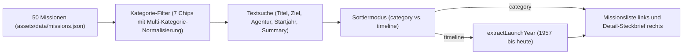
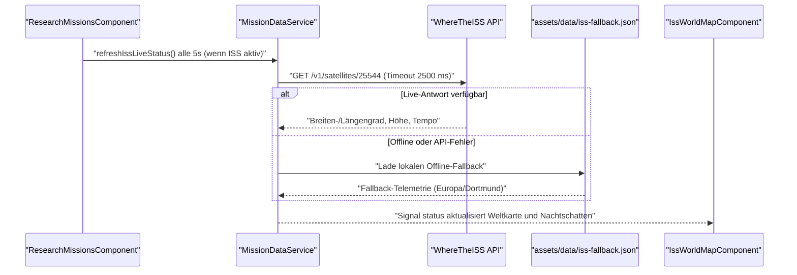

# Modul P40 – Forschungsprojekte und ISS-Live-Karte (`src/app/features/research-missions`)

Zurück zur [Haupt-Übersicht](../../../../README.md).

Das Modul **P40** präsentiert **50 internationale Raumfahrtmissionen** (Raumsonden, Rover, Weltraumteleskope, Raumstationen, Mondflüge und bemannte Missionen von 1957 bis heute) inklusive Textsuche, Kategorie- und Zeitstrahl-Umschalter, kuratierten Bildergalerien sowie der visuellen **2D-ISS-Weltkarte** mit Live-Telemetrie und Offline-Fallback.

## Inhaltsverzeichnis

1. [Filterpipeline und Sortierung](#1-filterpipeline-und-sortierung)
2. [ISS-Live-Telemetrie und Weltkarte](#2-iss-live-telemetrie-und-weltkarte)
3. [Dateistruktur](#3-dateistruktur)
4. [Datenherkunft und Datenquellen](#4-datenherkunft-und-datenquellen)
5. [Kernfunktionen und FCPP-Zuordnung](#5-kernfunktionen-und-fcpp-zuordnung)
6. [Technische Detailerklärungen und Codebeispiele](#6-technische-detailerklärungen-und-codebeispiele)
   - [6.1 Multi-Kategorie-Filter, 8-Feld-Volltextsuche und Zeitstrahl-Sortierung](#61-multi-kategorie-filter-8-feld-volltextsuche-und-zeitstrahl-sortierung)
   - [6.2 Dreistufiger ISS-Live-Fallback und 5-Sekunden-Auto-Polling](#62-dreistufiger-iss-live-fallback-und-5-sekunden-auto-polling)
   - [6.3 Equirectangular-Projektion, 51,64°-Sinusbahn und Tag-/Nacht-Terminator](#63-equirectangular-projektion-5164-sinusbahn-und-tag-nacht-terminator)
7. [Tests und Verifizierung](#7-tests-und-verifizierung)
8. [KI-Transparenz](#8-ki-transparenz)

## 1. Filterpipeline und Sortierung



## 2. ISS-Live-Telemetrie und Weltkarte



## 3. Dateistruktur

| Datei | Aufgabe | FCPP-Bezug |
| :--- | :--- | :--- |
| [`research-missions.ts`](./research-missions.ts) | Steuerlogik für Kategorie-Chips, Suche, Zeitstrahl-Toggle, Galerie-Lightbox, 5s-ISS-Auto-Polling und Deep-Link `?mission=` | `P40-U10`, `P40-U20` |
| [`research-missions.html`](./research-missions.html) | Header-Karte, Suchfeld, Sortier-Umschalter, Missionsliste links, Detail-Steckbrief, ISS-Live-Box und Sprung-Button nach `P20` | `P40-U10`, `P40-U20` |
| [`research-missions.css`](./research-missions.css) | Kontraststarke Kartenstyles im hellen und dunklen Design, Thumbnails, Zeitstrahl-Jahr-Badges (`#0B132B` statt `#000000`) | `P40-U10`, `P40-U20` |
| [`iss-world-map/iss-world-map.ts`](./iss-world-map/iss-world-map.ts) | 100 % offline-fähige Equirectangular-SVG-Weltkarte mit Kontinenten, Tag-/Nacht-Terminator und 51,64°-ISS-Bahnspur | `P40-U20` |
| [`research-missions.spec.ts`](./research-missions.spec.ts) | Integrationstest für Filter, Suche, Zeitstrahl, Galerie-Lightbox, Quellenlinks und ISS-Fallback | `P40-U20` |

## 4. Datenherkunft und Datenquellen

| Bereich | Primäre Quelle | Live-/Offline-Fallback |
| :--- | :--- | :--- |
| **`50` Raumfahrtmissionen** | [`public/assets/data/missions.json`](../../../../public/assets/data/missions.json) (`MissionDataService`) | Rein lokales Asset (`assets/data/missions.json`) ohne externe API |
| **ISS-Live-Telemetrie** | *WhereTheISS* REST-API (`https://api.wheretheiss.at/v1/satellites/25544`, `timeout(2500)`, 5s-Auto-Polling) | Zweistufig abgesichert durch [`public/assets/data/iss-fallback.json`](../../../../public/assets/data/iss-fallback.json) sowie einen im TypeScript-Service eingebetteten Notfall-Datensatz (*Europa / Dortmund*) |
| **Fotogalerien (`5`–`6` Fotos je Mission)** | Kuratierte Wikimedia-Commons- & NASA-Image-Library-URLs in [`media-gallery.data.ts`](../../core/data/media-gallery.data.ts) | Fehlerhafte/unerreichbare Fotos werden ausgeblendet; lokale SVGs liegen unter `public/assets/images/` |
| **2D-ISS-Weltkarte & Nachtschatten** | Inline-SVG-Kontinente in [`iss-world-map.ts`](./iss-world-map/iss-world-map.ts) | **Keine externe Karten-API:** Position, 51,64°-Umlaufbahn und aktueller Tag-/Nacht-Terminator werden rein im Browser aus Koordinaten und UTC-Zeit berechnet |

## 5. Kernfunktionen und FCPP-Zuordnung

- **Kategorien und internationale Missionen (`P40-U10`, `P40-U20`):** Sortier- und filterbar nach *Alle Projekte*, *Sonden*, *Rover*, *Teleskope*, *Raumstationen*, *Mondflüge* und *Bemannte Missionen* – inklusive historischer Meilensteine (*Sputnik 1* 1957, *Vanguard 1* 1958, *Wostok 1*, *Gemini 4 & 8*, *Apollo 7–17*), europäischer Missionen (*Giotto*, *Mars Express*, *Spacelab/Columbus*, *ATV*) und asiatischer Programme (*Chang'e 4*, *Tiangong*, *Shenzhou 5*, *Hayabusa2*, *SLIM*, *Akatsuki/Kibō*, *Chandrayaan-3*, *Mangalyaan/Gaganyaan*).
- **Textsuche und Zeitstrahl (`1957 → heute`):** `searchQuery` durchsucht Titel, Agenturen, Zielkörper, Startjahre und Kurzbeschreibungen; im Zeitstrahl-Modus sortiert `extractLaunchYear` alle Treffer chronologisch ab 1957 mit Jahres-Badge.
- **Bildergalerien und Quellen:** Jede Mission besitzt mindestens `5` kuratierte Fotos ([`media-gallery.data.ts`](../../core/data/media-gallery.data.ts)) mit `ImageLightboxComponent`, doppelte Quellenbuttons (`officialUrl` + `wikipediaUrl`) sowie einen direkten Navigationslink `/solar-system/:targetBodyId` nach `P20`.

## 6. Technische Detailerklärungen und Codebeispiele

### 6.1 Multi-Kategorie-Filter, 8-Feld-Volltextsuche und Zeitstrahl-Sortierung

Da viele Missionen in mehrere Rubriken fallen (z. B. *Apollo 11* sowohl unter *Mondflüge* als auch unter *Bemannte Missionen*, oder *Chang'e 4* unter *Rover* und *Mondflüge*), normiert `filteredMissions` in [`MissionDataService`](../../core/services/mission-data.service.ts) Synonyme (`rover` → `mars-rover`, `solar-probe`/`deep-space` → `probe`), prüft Hauptkategorie und optionale `categories[]` und filtert anschließend case-insensitive über 8 Metadatenfelder. Im Modus `'timeline'` extrahiert `extractLaunchYear()` per RegExp `/(19|20)\d{2}/` zuverlässig auch Startzeiträume wie `"1965–1966"` (`1965`) und sortiert aufsteigend ab 1957:

```typescript
// Ausschnitt aus src/app/core/services/mission-data.service.ts (Zeilen 56–126)
extractLaunchYear(launchYear: string): number {
  const match = /(19|20)\d{2}/.exec(launchYear ?? '');
  return match ? Number(match[0]) : 9999;
}

readonly filteredMissions = computed<ResearchMission[]>(() => {
  const category = this.selectedCategoryState();
  const query = this.searchQueryState().trim().toLowerCase();
  const sortMode = this.sortModeState();
  const all = this.missionsState();

  const normalize = (cat: string): string => {
    if (cat === 'rover') {
      return 'mars-rover';
    }
    if (cat === 'solar-probe' || cat === 'deep-space') {
      return 'probe';
    }
    return cat;
  };

  const normalizedTarget = normalize(category);
  let matches =
    category === 'all'
      ? all
      : all.filter((m) => {
          const primary = normalize(m.category);
          const extras = (m.categories ?? []).map((c) => normalize(c));
          return (
            primary === normalizedTarget ||
            m.category === category ||
            extras.includes(normalizedTarget) ||
            (m.categories ?? []).includes(category)
          );
        });

  if (query.length > 0) {
    matches = matches.filter((m) => {
      const haystack = [
        m.title,
        m.subtitle,
        m.agency,
        m.targetBodyName,
        m.launchYear,
        m.categoryLabel,
        m.statusLabel,
        m.childSummary,
      ]
        .join(' ')
        .toLowerCase();
      return haystack.includes(query);
    });
  }

  if (sortMode === 'timeline') {
    return [...matches].sort(
      (a, b) => this.extractLaunchYear(a.launchYear) - this.extractLaunchYear(b.launchYear),
    );
  }

  if (category === 'all') {
    return matches;
  }

  return [...matches].sort((a, b) => {
    const aPrimary = normalize(a.category) === normalizedTarget ? 0 : 1;
    const bPrimary = normalize(b.category) === normalizedTarget ? 0 : 1;
    return aPrimary - bPrimary;
  });
});
```

### 6.2 Dreistufiger ISS-Live-Fallback und 5-Sekunden-Auto-Polling

Die ISS-Telemetrie arbeitet strikt dreistufig ausfallsicher: (1) Live-Abfrage an `api.wheretheiss.at/v1/satellites/25544` mit hartem `timeout(2500)`, (2) Fallback auf das lokale Asset `assets/data/iss-fallback.json` (`isFallbackData: true`), (3) eingebetteter Typ-Fallback (*Überflug Europa / Dortmund*, `416.8 km`), falls selbst das Asset nicht erreichbar wäre. In [`ResearchMissionsComponent`](./research-missions.ts) pollt das 5-Sekunden-Intervall ressourcenschonend nur dann, wenn die ISS gerade ausgewählt ist (`hasIssLiveTracker`), Auto-Refresh aktiv ist und kein Request mehr läuft; `ngOnDestroy` räumt den Timer sauber ab:

```typescript
// Ausschnitt aus src/app/core/services/mission-data.service.ts (Zeilen 163–205)
async refreshIssLiveStatus(): Promise<IssLiveStatus> {
  const live = await firstValueFrom(
    this.http.get<WhereTheIssApiResponse>(this.issLiveApiUrl).pipe(
      timeout(2500),
      catchError(() => of(null)),
    ),
  );

  if (live && typeof live.latitude === 'number') {
    const status: IssLiveStatus = {
      latitude: Number(live.latitude.toFixed(4)),
      longitude: Number(live.longitude.toFixed(4)),
      altitudeKm: Number(live.altitude.toFixed(1)),
      velocityKmh: Math.round(live.velocity),
      visibility: live.visibility,
      timestamp: live.timestamp,
      locationHint: 'Live-Empfang von Satelliten-Telemetrie (WhereTheISS.at)',
      isFallbackData: false,
    };
    this.issStatusState.set(status);
    return status;
  }

  const fallback = await firstValueFrom(
    this.http.get<IssLiveStatus>(this.issFallbackUrl).pipe(
      catchError(() =>
        of({
          latitude: 51.5136,
          longitude: 7.4653,
          altitudeKm: 416.8,
          velocityKmh: 27584,
          visibility: 'daylight',
          timestamp: 1794826000,
          locationHint: 'Überflug Europa / Dortmund (Lokaler Offline-Fallback aktiv)',
          isFallbackData: true,
        } satisfies IssLiveStatus),
      ),
    ),
  );

  this.issStatusState.set(fallback);
  return fallback;
}
```

```typescript
// Ausschnitt aus src/app/features/research-missions/research-missions.ts (Zeilen 109–127)
private startIssAutoRefresh(): void {
  this.stopIssAutoRefresh();
  this.issPollTimerId = setInterval(() => {
    if (
      this.issAutoRefreshEnabled() &&
      this.missionService.selectedMission()?.hasIssLiveTracker &&
      !this.isRefreshingIss()
    ) {
      void this.refreshIssTelemetry();
    }
  }, 5000);
}

private stopIssAutoRefresh(): void {
  if (this.issPollTimerId !== null) {
    clearInterval(this.issPollTimerId);
    this.issPollTimerId = null;
  }
}
```

### 6.3 Equirectangular-Projektion, 51,64°-Sinusbahn und Tag-/Nacht-Terminator

[`IssWorldMapComponent`](./iss-world-map/iss-world-map.ts) zeichnet eine komplett offline-fähige Weltkarte im Format `720 × 360` (`2 px` pro Grad). Damit besitzt die Projektion eine triviale lineare Umrechnung: $x = (\text{lon} + 180) \cdot 2$ und $y = (90 - \text{lat}) \cdot 2$. Für `orbitTrackSegments` berechnet eine sphärische Sinusprojektion aus der Bahnneigung $51{,}64^\circ$ eine vollständige Erdumrundung – sobald der Längengrad über $\pm 180^\circ$ springt (`Math.abs(x - prevX) > 250`), bricht die Routine den SVG-Pfad sauber auf ein neues `M`-Segment um, damit keine waagerechten Striche quer über die Weltkarte entstehen. `nightShadowPath` berechnet parallel aus aktueller UTC-Uhrzeit (subsolarer Längengrad) und Jahrestag (Sonnendeklination $\pm 23{,}44^\circ$) den exakten Tag-/Nacht-Terminator:

```typescript
// Ausschnitt aus src/app/features/research-missions/iss-world-map/iss-world-map.ts (Zeilen 160–232)
readonly issPoint = computed<{ x: number; y: number }>(() => {
  const s = this.status();
  return {
    x: Number(((s.longitude + 180) * 2).toFixed(1)),
    y: Number(((90 - s.latitude) * 2).toFixed(1)),
  };
});

readonly orbitTrackSegments = computed<string[]>(() => {
  const s = this.status();
  const incRad = (51.64 * Math.PI) / 180;
  const clampedLat = Math.max(-51.5, Math.min(51.5, s.latitude));
  const phase = Math.asin(Math.sin((clampedLat * Math.PI) / 180) / Math.sin(incRad));

  const segments: string[] = [];
  let currentPath: string[] = [];
  let prevX: number | null = null;

  for (let step = -70; step <= 70; step++) {
    const u = phase + (step * Math.PI) / 50;
    const lat = (Math.asin(Math.sin(incRad) * Math.sin(u)) * 180) / Math.PI;
    const rawLon = s.longitude + step * 2.4;
    const wrappedLon = ((((rawLon + 180) % 360) + 360) % 360) - 180;

    const x = Number(((wrappedLon + 180) * 2).toFixed(1));
    const y = Number(((90 - lat) * 2).toFixed(1));

    if (prevX !== null && Math.abs(x - prevX) > 250) {
      if (currentPath.length > 1) {
        segments.push(currentPath.join(' '));
      }
      currentPath = [`M${x} ${y}`];
    } else {
      currentPath.push(`${currentPath.length === 0 ? 'M' : 'L'}${x} ${y}`);
    }
    prevX = x;
  }

  if (currentPath.length > 1) {
    segments.push(currentPath.join(' '));
  }
  return segments;
});

readonly nightShadowPath = computed<string>(() => {
  const now = new Date();
  const utcHours = now.getUTCHours() + now.getUTCMinutes() / 60;
  const subsolarLon = (12 - utcHours) * 15;
  const startOfYear = Date.UTC(now.getUTCFullYear(), 0, 1);
  const dayOfYear = Math.floor((now.getTime() - startOfYear) / 86400000);
  const declRad = (-23.44 * Math.cos(((2 * Math.PI) / 365) * (dayOfYear + 10)) * Math.PI) / 180;

  const pts: string[] = [];
  const tanDecl = Math.tan(declRad);
  const safeTan = Math.abs(tanDecl) < 0.01 ? 0.01 : tanDecl;

  for (let lon = -180; lon <= 180; lon += 6) {
    const dLonRad = ((lon - subsolarLon) * Math.PI) / 180;
    const latRad = Math.atan(-Math.cos(dLonRad) / safeTan);
    const latDeg = (latRad * 180) / Math.PI;
    const x = (lon + 180) * 2;
    const y = (90 - latDeg) * 2;
    pts.push(`${lon === -180 ? 'M' : 'L'}${x.toFixed(1)} ${y.toFixed(1)}`);
  }

  const closeY = declRad >= 0 ? 360 : 0;
  pts.push(`L720 ${closeY} L0 ${closeY} Z`);
  return pts.join(' ');
});
```

## 7. Tests und Verifizierung

[`research-missions.spec.ts`](./research-missions.spec.ts) (`1` umfassender Integrationstest) prüft:

- Kategoriefilterung (*Alle Projekte* bis *Bemannte Missionen*) und bedingte Anzeige des ISS-Live-Trackers mit Offline-Fallback (`416.8 km`).
- Vor-/Zurück-Blättern innerhalb `ImageLightboxComponent` ohne Schließen des Dialogs.
- Chronologische Zeitstrahl-Sortierung (*Gemini 4* 1965 vor *ISS*, *Parker*, *Perseverance*, *JWST*), Textsuche (`'Gemini'`), Trefferzähler, Leerzustand und Reset-Button.

## 8. KI-Transparenz

Alle Komponentendateien dokumentieren die KI-Unterstützung gemäß `.agents/AGENTS.md` im Datei-Header sowie chronologisch im [`AI-LOG.md`](../../../../AI-LOG.md).
