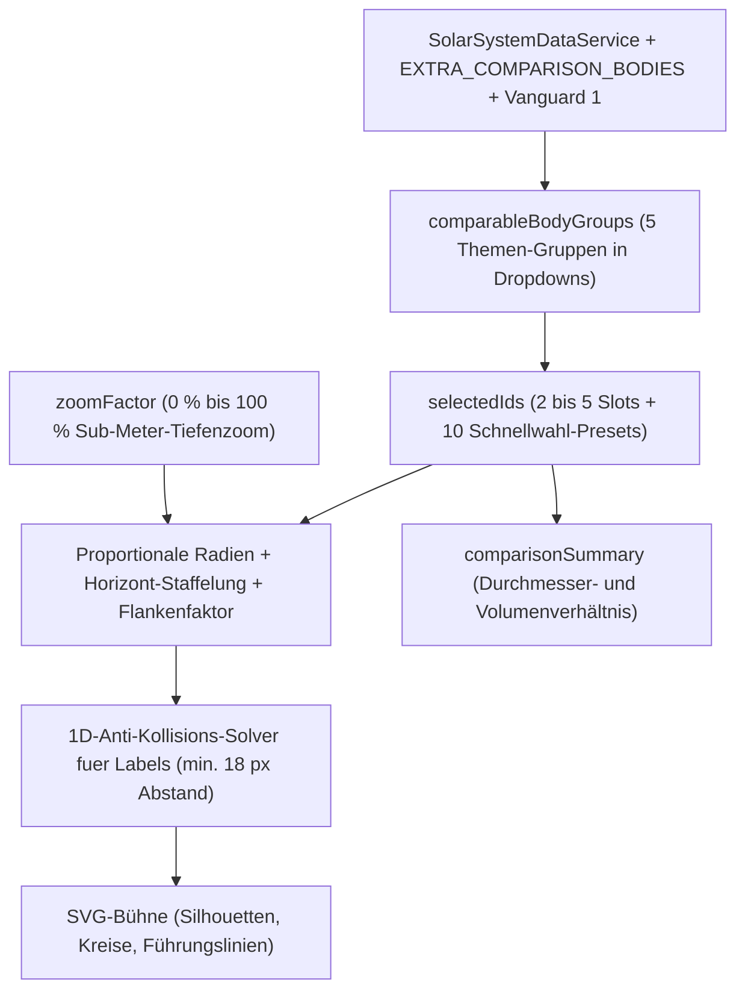

# Modul P30 – Maßstabs- und Größenvergleich (`src/app/features/size-comparison`)

Zurück zur [Haupt-Übersicht](../../../../README.md).

Das Modul **P30** (Route `/size-comparison`) ermöglicht Grundschulkindern den direkten maßstabsgetreuen Vergleich von **2 bis 5 Objekten** nebeneinander – vom nur `16,5 cm` kleinen US-Satelliten **Vanguard 1** über *Fußball* (`22 cm`), *Mount Everest* (`9 km`), *Deutschland* (`876 km`), unsere Planeten und Monde bis zu Exoplaneten, Neutronensternen, *Sagittarius A\** und Hyperriesen wie *Stephenson 2-18*.

## Inhaltsverzeichnis

1. [Skalierung und Anti-Kollisions-Pipeline](#1-skalierung-und-anti-kollisions-pipeline)
2. [Dateistruktur](#2-dateistruktur)
3. [Datenherkunft und Datenquellen](#3-datenherkunft-und-datenquellen)
4. [Kernfunktionen und FCPP-Zuordnung](#4-kernfunktionen-und-fcpp-zuordnung)
5. [Technische Detailerklärungen und Codebeispiele](#5-technische-detailerklärungen-und-codebeispiele)
   - [5.1 Dynamischer Sub-Meter-Tiefenzoom](#51-dynamischer-sub-meter-tiefenzoom)
   - [5.2 Horizont-Staffelung, Silhouetten-Flankenfaktor und Z-Order-Sortierung](#52-horizont-staffelung-silhouetten-flankenfaktor-und-z-order-sortierung)
   - [5.3 16-Pass-1D-Anti-Kollisions-Solver für Beschriftungen](#53-16-pass-1d-anti-kollisions-solver-für-beschriftungen)
   - [5.4 Automatisches Durchmesser- und Volumenverhältnis](#54-automatisches-durchmesser--und-volumenverhältnis)
6. [Tests und Verifizierung](#6-tests-und-verifizierung)
7. [KI-Transparenz](#7-ki-transparenz)

## 1. Skalierung und Anti-Kollisions-Pipeline



## 2. Dateistruktur

| Datei | Aufgabe | FCPP-Bezug |
| :--- | :--- | :--- |
| [`size-comparison.ts`](./size-comparison.ts) | Vergleichslogik, Sub-Meter-Tiefenzoom, `cm`/`m`/`km`-Formatierung, SVG-Silhouetten-Kalibrierung (`getHorizontalEdgeFactor`), Anti-Kollisions-Labels und Verhältnis-Berechnung | `P30-U10`, `P30-U20` |
| [`size-comparison.html`](./size-comparison.html) | Preset-Buttons, 2–5 gruppierte Dropdown-Slots, Zoom-Slider-Steuerung, SVG-Bühne (`viewBox 0 0 1200 500`), Kindfrage-Karte und Wikipedia-Kurzinfos | `P30-U10`, `P30-U20` |
| [`size-comparison.css`](./size-comparison.css) | Kontrastreiche Auswahlkarten, Marineblau-Weltraumbühne (`#0B132B`), Ergebnis-Banner und Responsive-Styles | `P30-U10`, `P30-U20` |
| [`extra-comparison-bodies.data.ts`](./extra-comparison-bodies.data.ts) | `19` Zusatzobjekte (Alltagsbälle, Mount Everest, Deutschland, Exoplaneten, Neutronenstern, *Sagittarius A\**, Riesensterne) + `EVERYDAY_COMPARISON_IDS` inkl. `vanguard-1` | `P30-U10`, `P30-U20` |
| [`size-comparison.spec.ts`](./size-comparison.spec.ts) | Unit-Tests für proportionale Radien, `(D1 / D2)^3`-Volumenverhältnis sowie überlappungsfreie Beschriftung beim Zoomen | `P30-U20` |

## 3. Datenherkunft und Datenquellen

| Datenbereich | Quelle | Beschreibung |
| :--- | :--- | :--- |
| **Sonnensystem-Objekte & *Vanguard 1*** | [`public/assets/data/solar-system-fallback.json`](../../../../public/assets/data/solar-system-fallback.json) über [`SolarSystemDataService`](../../core/README.md) | Enthält Sonne, Planeten, Monde, Zwergplaneten, Kometen und `vanguard-1` (ohne Gürtel & Lagrange-Punkte); Durchmesser ggf. per OpenData-API angereichert |
| **`19` Zusatz-Vergleichsobjekte** | [`extra-comparison-bodies.data.ts`](./extra-comparison-bodies.data.ts) | Statische TypeScript-Daten für Alltagsbälle (*Fußball*, *Basketball*, *1-Meter-Kugel*), *Mount Everest*, *Deutschland*, Exoplaneten, Neutronenstern, *Sagittarius A\** und Riesensterne |
| **Radien, Silhouetten & Verhältnisse** | **Reine Browser-Berechnung** (`SizeComparisonComponent`) | Proportionale Skalierung, Tiefenzoom, Flankenfaktor, 16-Pass-Label-Solver und $(D_{\max}/D_{\min})^3$-Auswertung laufen ohne externe API |

## 4. Kernfunktionen und FCPP-Zuordnung

- **2 bis 5 Objekte und thematische Gruppen (`P30-U10`):** Gruppierte `<optgroup>`-Dropdowns unterteilen in *Sonne und Planeten*, *Zwergplaneten, Monde und Kometen*, *Alltag und Erde (Bälle, Berge, Länder und Vanguard 1)*, *Exoplaneten* sowie *Ferne Sterne, Neutronensterne und Schwarze Löcher*.
- **Sub-Meter-Tiefenzoom und Horizont-Staffelung (`P30-U20`):** `maxZoomFactor` skaliert dynamisch bezogen auf das kleinste Objekt (`min. 0.0000001 km`), sodass selbst ein 22-cm-Fußball oder der 16,5-cm-Satellit *Vanguard 1* neben Riesensternen sichtbar herangezoomt werden kann, während große Körper als gekrümmte Horizonte stehen bleiben.
- **SVG-Silhouetten und Einheitenformatierung:** *Mount Everest* (`Höhe 8,9 km`) und *Deutschland* (`Nord-Süd 876 km`) nutzen maßstabsgetreue Vektor-Silhouetten statt Kugeln; `formatDiameter` wählt selbstständig `cm`, `m` oder `km`.
- **Überlappungsfreie Beschriftung und Volumenverhältnis:** Der 16-Pass-Kollisionslöser verteilt enge Labels waagerecht mit gestrichelten Führungslinien; `comparisonSummary` beantwortet kindgerecht *„Wie oft passt das kleinere Objekt in das größere?“* über `(D_largest / D_smallest)^3`.

## 5. Technische Detailerklärungen und Codebeispiele

### 5.1 Dynamischer Sub-Meter-Tiefenzoom

In einem naiven linearen Größenvergleich zwischen dem Hyperriesen *Stephenson 2-18* (`2.990.000.000 km`) und dem Satelliten *Vanguard 1* (`0,000165 km`) läge das kleinere Objekt mit $10^{-11}$ Pixeln weit unterhalb der Subpixel-Grenze. [`SizeComparisonComponent`](./size-comparison.ts) berechnet daher mit `maxZoomFactor` einen dynamischen Maximalzoom `(largest / smallest) * 0.85` (Bodenwert `0.0000001 km` = `10 cm`) und bildet den `0 %`–`100 %`-Slider exponentiell über `Math.pow(maxZ, pct / 100)` ab: So lassen sich sowohl erste Planetenunterschiede feinfühlig regeln als auch am rechten Anschlag Winzlinge groß darstellen:

```typescript
// Ausschnitt aus src/app/features/size-comparison/size-comparison.ts (Zeilen 69–84)
readonly maxZoomFactor = computed<number>(() => {
  const bodies = this.selectedBodies();
  if (bodies.length < 2) {
    return 12;
  }
  const sorted = [...bodies].sort((a, b) => b.diameterKm - a.diameterKm);
  const largest = sorted[0].diameterKm;
  const smallest = Math.max(0.0000001, sorted[sorted.length - 1].diameterKm);
  return Math.max(8, Number(((largest / smallest) * 0.85).toFixed(2)));
});

readonly zoomFactor = computed<number>(() => {
  const pct = this.zoomSliderPercent();
  const maxZ = this.maxZoomFactor();
  return Number(Math.pow(maxZ, pct / 100).toFixed(3));
});
```

### 5.2 Horizont-Staffelung, Silhouetten-Flankenfaktor und Z-Order-Sortierung

Wächst beim Reinzoomen ein großer Himmelskörper über `185 px` Radius hinaus (`drawnR` geklemmt bei `8000 px`), schrumpft sein virtueller Layout-Halbwert `boxHalf` gezielt auf bis zu `55 px`, während der sichtbare Körperrand an der dem kleinsten Fokusobjekt (`focusIdx`) zugewandten Seite gepinnt bleibt. Dadurch rückt der Riesenstern als gekrümmter leuchtender Horizont ins Bild, ohne seine Nachbarn zuzudecken. Bei den Vektor-Silhouetten von *Mount Everest* (`0.62`) und *Deutschland* (`0.72`) korrigiert `getHorizontalEdgeFactor` die engere Flankenbreite gegenüber Vollkreisen (`1.0`). Abschließend sortiert `renderOrderedItems()` alle SVG-Elemente aufsteigend nach ihrem Slot-Abstand zu `focusIdx`, sodass die größeren Körper hinter den kleineren liegen:

```typescript
// Ausschnitt aus src/app/features/size-comparison/size-comparison.ts (Zeilen 233–278 & 380–394 & 535–543)
const drawnRadii = bodies.map((b) => {
  const trueRatio = b.diameterKm / maxDiameter;
  const truePixelRadius = Number((trueRatio * baseMaxRadiusPx * zoom).toFixed(2));
  const rawSvgRadiusPx = Math.max(2.5, truePixelRadius);
  const drawnR = Math.min(8000, rawSvgRadiusPx);
  const over = rawSvgRadiusPx > 185 ? Math.min(1, (rawSvgRadiusPx - 185) / 500) : 0;
  const boxHalf = rawSvgRadiusPx <= 185 ? rawSvgRadiusPx : 185 * (1 - over) + 55 * over;
  return {
    truePixelRadius,
    rawSvgRadiusPx,
    drawnR,
    boxHalf,
  };
});

// ...
const edgeFactorX = this.getHorizontalEdgeFactor(body.id);
const effectiveReachPx = info.drawnR * edgeFactorX;
const anchorLeftSide = idx < focusIdx || (idx === focusIdx && idx === 0);
if (effectiveReachPx > info.boxHalf) {
  zoomedCenterX = anchorLeftSide
    ? anchorX + info.boxHalf - effectiveReachPx
    : anchorX - info.boxHalf + effectiveReachPx;
}

readonly renderOrderedItems = computed<ScaledComparisonItem[]>(() => {
  const items = this.scaledItems();
  if (items.length <= 1) {
    return items;
  }
  let focusIdx = 0;
  for (let i = 1; i < items.length; i++) {
    if (items[i].body.diameterKm < items[focusIdx].body.diameterKm) {
      focusIdx = i;
    }
  }
  return [...items].sort(
    (a, b) => Math.abs(a.slotIndex - focusIdx) - Math.abs(b.slotIndex - focusIdx),
  );
});

getHorizontalEdgeFactor(bodyId: string): number {
  if (bodyId === 'mount-everest') {
    return 0.62;
  }
  if (bodyId === 'germany-size') {
    return 0.72;
  }
  return 1;
}
```

### 5.3 16-Pass-1D-Anti-Kollisions-Solver für Beschriftungen

Wenn bis zu fünf Vergleichsobjekte beim tiefen Reinzoomen nah beieinanderstehen, würden ihre Textlabels ohne Ausweichlogik überlappen. `scaledItems` schätzt daher zunächst für jedes Objekt eine konservative Textbox-Breite (`labelWidthPx`), spannt den nutzbaren Bühnenbereich `[36 .. 1164]` auf und trennt benachbarte Boxen in **16 iterativen Feder-Abstoßungsdurchläufen** mindestens `minLabelGapPx = 18` auseinander. Ein Vorwärts- und ein Rückwärts-Korrekturpass garantieren anschließend strikte Überlappungsfreiheit am rechten Bühnenrand; weicht ein Label mehr als `12 px` von seinem Ankerpunkt ab (`showLeaderLine`), zeichnet die SVG eine gestrichelte Zeigerlinie zum Körperrand:

```typescript
// Ausschnitt aus src/app/features/size-comparison/size-comparison.ts (Zeilen 319–376)
const n = provisional.length;
const halfWidths = provisional.map((it) => Math.ceil(it.labelWidthPx / 2));
const xs = provisional.map((it) => it.rawLabelX);
const minLabelGapPx = 18;
const minBound = 36 + halfWidths[0];
const maxBound = 1164 - halfWidths[n - 1];

for (let pass = 0; pass < 16; pass++) {
  for (let i = 0; i < n - 1; i++) {
    const minDist = halfWidths[i] + halfWidths[i + 1] + minLabelGapPx;
    const diff = xs[i + 1] - xs[i];
    if (diff < minDist) {
      const push = (minDist - diff) / 2;
      xs[i] -= push;
      xs[i + 1] += push;
    }
  }
  if (xs[0] < minBound) {
    xs[0] = minBound;
  }
  if (xs[n - 1] > maxBound) {
    xs[n - 1] = maxBound;
  }
}
for (let i = 1; i < n; i++) {
  const minDist = halfWidths[i - 1] + halfWidths[i] + minLabelGapPx;
  if (xs[i] < xs[i - 1] + minDist) {
    xs[i] = xs[i - 1] + minDist;
  }
}
if (xs[n - 1] > maxBound) {
  xs[n - 1] = maxBound;
  for (let i = n - 2; i >= 0; i--) {
    const minDist = halfWidths[i] + halfWidths[i + 1] + minLabelGapPx;
    if (xs[i] > xs[i + 1] - minDist) {
      xs[i] = xs[i + 1] - minDist;
    }
  }
}

return provisional.map((item, idx) => {
  const labelX = Math.round(xs[idx]);
  return {
    slotIndex: item.slotIndex,
    body: item.body,
    svgRadiusPx: item.svgRadiusPx,
    truePixelRadius: item.truePixelRadius,
    centerX: item.centerX,
    labelX,
    svgLabelName: item.svgLabelName,
    dimensionLabel: item.dimensionLabel,
    labelWidthPx: item.labelWidthPx,
    pointerTargetX: item.pointerTargetX,
    pointerTargetY: item.pointerTargetY,
    showLeaderLine:
      Math.abs(labelX - item.pointerTargetX) > 12 || item.svgRadiusPx > 185,
  };
});
```

### 5.4 Automatisches Durchmesser- und Volumenverhältnis

Das Computed-Signal `comparisonSummary` bestimmt aus den gewählten Objekten den linearen Längenfaktor $D_{\max} / D_{\min}$ sowie bei dreidimensionalen Kugelkörpern das Volumenverhältnis $(D_{\max} / D_{\min})^3$. Für nicht-kugelförmige Silhouetten (*Mount Everest*, *Deutschland*) wählt es automatisch einen sachlich korrekten Längen-/Höhenvergleich ohne Kugelvolumen:

```typescript
// Ausschnitt aus src/app/features/size-comparison/size-comparison.ts (Zeilen 413–453 & 521–532)
const sorted = [...bodies].sort((a, b) => b.diameterKm - a.diameterKm);
const largest = sorted[0];
const smallest = sorted[sorted.length - 1];

const diameterRatio = Number(
  (largest.diameterKm / Math.max(0.0000001, smallest.diameterKm)).toFixed(1),
);
const rawVolumeRatio = Math.pow(
  largest.diameterKm / Math.max(0.0000001, smallest.diameterKm),
  3,
);
const volumeRatio =
  rawVolumeRatio >= 100
    ? Math.round(rawVolumeRatio)
    : Number(rawVolumeRatio.toFixed(1));

const hasNonSpherical =
  largest.id === 'mount-everest' ||
  largest.id === 'germany-size' ||
  smallest.id === 'mount-everest' ||
  smallest.id === 'germany-size';

let childAnswer: string;
if (largest.id === smallest.id) {
  childAnswer = `Du hast zweimal ${largest.name} ausgewählt – beide sind exakt gleich groß (Verhältnis 1 : 1)!`;
} else if (hasNonSpherical) {
  childAnswer = `${largest.name} (${this.formatBodyDimension(largest)}) ist in seiner größten Ausdehnung rund ${diameterRatio.toLocaleString('de-DE')}-mal so groß wie ${smallest.name} (${this.formatBodyDimension(smallest)}).`;
} else {
  childAnswer = `${largest.name} (${this.formatBodyDimension(largest)}) ist vom Durchmesser her rund ${diameterRatio.toLocaleString('de-DE')}-mal so breit wie ${smallest.name} (${this.formatBodyDimension(smallest)}). Vom Volumen (Rauminhalt) her würde ${smallest.name} sogar rund ${volumeRatio.toLocaleString('de-DE')}-mal in ${largest.name} hineinpassen!`;
}

formatDiameter(diameterKm: number): string {
  if (diameterKm < 0.001) {
    const cm = Number((diameterKm * 100_000).toFixed(1));
    return `${cm.toLocaleString('de-DE', { maximumFractionDigits: 1 })} cm`;
  }
  if (diameterKm < 1) {
    const meters = Number((diameterKm * 1_000).toFixed(1));
    return `${meters.toLocaleString('de-DE', { maximumFractionDigits: 1 })} m`;
  }
  const km = Number(diameterKm.toFixed(1));
  return `${km.toLocaleString('de-DE', { maximumFractionDigits: 1 })} km`;
}
```

## 6. Tests und Verifizierung

[`size-comparison.spec.ts`](./size-comparison.spec.ts) (`1` Test) verifiziert:

- Proportionales Radien-Verhältnis (`109,2x`) und Volumenverhältnis (`1.301.874x`) von Sonne vs. Erde.
- Überlappungsfreie Label-Positionierung für `['sun', 'stephenson-2-18', 'earth']` auch bei starkem Zoom (`76 %`).

## 7. KI-Transparenz

Die KI-Kennzeichnung ist in den Datei-Headern von [`size-comparison.ts`](./size-comparison.ts) und [`extra-comparison-bodies.data.ts`](./extra-comparison-bodies.data.ts) sowie im [`AI-LOG.md`](../../../../AI-LOG.md) hinterlegt.
