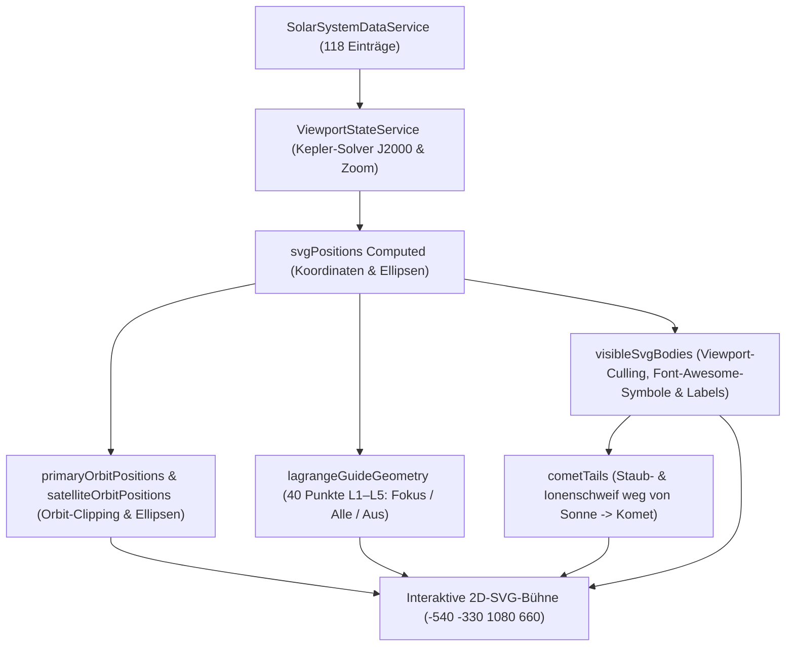
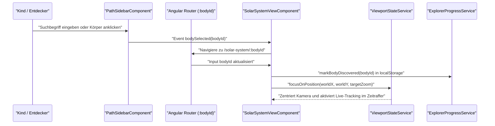

# Modul P10 – Interaktive 2D-SVG-Sternenkarte (`src/app/features/solar-system-view`)

Zurück zur [Haupt-Übersicht](../../../../README.md) · Weiter zu [Modul P20 Infobox-Steckbrief](./infobox-detail/README.md).

Das Modul **P10** bildet das interaktive Herzstück der **SSI App** (Routen `/solar-system` und `/solar-system/:bodyId`). Kinder und Entdecker navigieren über die **2D-SVG-Sternenkarte**, den **Entdecker-Pfad** links oder die **Breadcrumb-Leiste** durch alle **118 Einträge** des Sonnensystems – stufenlos zoombar von `0.08x` bis `36.000x` und inklusive historischer Zeitreise von `1950` bis `2100`.

## Inhaltsverzeichnis

- [Modul P10 – Interaktive 2D-SVG-Sternenkarte (`src/app/features/solar-system-view`)](#modul-p10--interaktive-2d-svg-sternenkarte-srcappfeaturessolar-system-view)
  - [Inhaltsverzeichnis](#inhaltsverzeichnis)
  - [1. SVG-Render-Pipeline](#1-svg-render-pipeline)
  - [2. Navigation und Kameraablauf](#2-navigation-und-kameraablauf)
  - [3. Dateistruktur](#3-dateistruktur)
  - [4. Datenherkunft und Datenquellen](#4-datenherkunft-und-datenquellen)
  - [5. Technische Detailerklärungen und Codebeispiele](#5-technische-detailerklärungen-und-codebeispiele)
    - [5.1 Route-Synchronisation und Live-Tracking mit untracked](#51-route-synchronisation-und-live-tracking-mit-untracked)
    - [5.2 Dynamische Anti-Solar-Kometenschweife](#52-dynamische-anti-solar-kometenschweife)
    - [5.3 Gedrehte Satelliten-Ellipsen und Orbit-Clipping im SVG](#53-gedrehte-satelliten-ellipsen-und-orbit-clipping-im-svg)
    - [5.4 Aliasing-freie 30-FPS-Zeitraffer und 3-Stufen-Lagrange-Filter](#54-aliasing-freie-30-fps-zeitraffer-und-3-stufen-lagrange-filter)
  - [6. Tests und Verifizierung](#6-tests-und-verifizierung)
  - [7. KI-Transparenz](#7-ki-transparenz)

## 1. SVG-Render-Pipeline



## 2. Navigation und Kameraablauf



## 3. Dateistruktur

| Pfad | Aufgabe | FCPP-Bezug |
| :--- | :--- | :--- |
| [`solar-system-view.ts`](./solar-system-view.ts) | Steuerung von Ansichtsmodi, Objekt-/Historienfiltern, `cometTails`, adaptiver 30-FPS-Zeitraffer-Logik, Zoom/Pan und Vollbildmodus | `P10-U20` bis `P10-U40` |
| [`solar-system-view.html`](./solar-system-view.html) | Zweispalten-Workspace mit `PathSidebarComponent`, `BreadcrumbBarComponent`, Toolbar, 2D-SVG-Bühne und `InfoboxDetailComponent` | `P10-U20` bis `P10-U40` |
| [`solar-system-view.css`](./solar-system-view.css) | Marineblaues Weltraum-Canvas (`#111D3B` ohne `#000000`), Toolbar, Zoom-Panel, Maßstabs-Lineal und Vollbild-Styles | `P10-U30`, `P10-U40` |
| [`infobox-detail/`](./infobox-detail/README.md) | Eingebettetes Untermodul **P20** für Steckbrief, Fotogalerie, Reisezeit-Vergleich, 7 Bahnelemente und Quellen | `P20-U10` bis `P20-U40` |
| [`solar-system-view.spec.ts`](./solar-system-view.spec.ts) | Integrations-Tests für Maßstabswechsel, Tracking, Lagrange-Filter, Zeitraffer, Suche, Reisezeit und Kometenschweif | `P10`, `P20` |

## 4. Datenherkunft und Datenquellen

Die Sternenkarte (`P10`) kombiniert vier **Offline-First**-Datenquellen:

| Bereich | Primäre Quelle | Live-/Laufzeit-Quelle oder Fallback | Bereitgestellt durch |
| :--- | :--- | :--- | :--- |
| **118 Katalog-Einträge (Stammdaten & `J2000`-Bahnelemente)** | [`public/assets/data/solar-system-fallback.json`](../../../../public/assets/data/solar-system-fallback.json) (`assets/data/solar-system-fallback.json`) | Optionale Anreicherung der Durchmesser (`meanRadius * 2` via `englishApiId`) über die *Solar System OpenData API* (`https://api.le-systeme-solaire.net/rest/bodies`, `timeout(2500)`) | [`SolarSystemDataService`](../../core/README.md) |
| **Planeten-, Mond-, Satelliten- & Kometenpositionen, 40 L-Punkte, Orbits** | Aus `J2000.0`-Bahnelementen (`SMA`, `ECC`, `INC`, `LAN`, `LPE`, `MNA`, `orbitalPeriodDays`) und gewähltem Datum (`1950`–`2100`) | **Reine Browser-Mathematik** (Kepler-Solver, Orbit-Clipping, Anti-Solar-Kometenschweif `cometTails`) + historische Abstands-Interpolation (*Voyager 1/2*, *New Horizons*) & Startdaten (`spacecraftActiveFromIso`); **keine** Live-Positions-API | `ViewportStateService` & `SolarSystemViewComponent` |
| **Steckbrief-Fotos (`5`–`6` je Objekt) & verknüpfte Missionen** | Kuratierte Wikimedia-/NASA-URLs in [`media-gallery.data.ts`](../../core/data/media-gallery.data.ts) & [`missions.json`](../../../../public/assets/data/missions.json) | `11` lokale Kategorie-SVGs unter `public/assets/images/` für 100 % Offline-Darstellung | `InfoboxDetailComponent` (`P20`) & `MissionDataService` |
| **Entdecker-Pass & aktuelle Auswahl** | URL-Parameter `:bodyId` (`/solar-system/:bodyId`) | Lokaler Browser-Speicher (`localStorage`-Schlüssel `ssi_app_discovered_bodies_v1`, `X / 118 entdeckt`) | Angular Router & [`ExplorerProgressService`](../../core/README.md#54-robuste-localstorage-persistenz-im-entdecker-pass) |

## 5. Technische Detailerklärungen und Codebeispiele

### 5.1 Route-Synchronisation und Live-Tracking mit untracked

[`SolarSystemViewComponent`](./solar-system-view.ts) nutzt Angulars `withComponentInputBinding()`, sodass der URL-Parameter `:bodyId` direkt als Signal-Input `readonly bodyId = input<string>()` ankommt. Im Konstruktor verknüpfen zwei getrennte `effect()`-Blöcke Routing, Kamerafokus und Zeitraffer-Tracking:

1. **Effekt 1 (Auswahl & Zielzoom):** Reagiert auf Änderungen an `bodyId()` oder dem geladenen Katalog `bodies()`, markiert das Objekt im `ExplorerProgressService` (`selectBody`), ermittelt mit `computeTargetZoomForBody()` einen passenden Startzoom (z. B. `8000` für *Vanguard 1* oder die *ISS*) und zentriert die Kamera einmalig mit den exakt dafür neu berechneten Mond-/Satelliten-Offsets.
2. **Effekt 2 (Kamera-Verfolgung):** Reagiert im laufenden Zeitraffer oder beim manuellen Zoomen auf `simulationDate()` und `zoomLevel()` und führt die Weltkoordinaten über `syncTrackedPosition` nach. Alle internen Schreibzugriffe sind in `untracked(() => ...)` gekapselt, um Zyklen mit `panX`/`panY` strikt auszuschließen.

```typescript
// Ausschnitt aus src/app/features/solar-system-view/solar-system-view.ts (Zeilen 538–583)
constructor() {
  effect(() => {
    const routeBodyId = this.bodyId() ?? null;
    const bodies = this.dataService.bodies();

    untracked(() => {
      this.dataService.selectBody(routeBodyId);

      if (routeBodyId && bodies.length > 0) {
        const target = bodies.find((b) => b.id === routeBodyId);
        if (target) {
          const targetZoom = this.computeTargetZoomForBody(target);

          this.viewport.setZoom(targetZoom);
          const pos = this.viewport.computeBodyPosition(target, bodies);
          this.viewport.focusOnPosition(pos.worldX, pos.worldY, targetZoom);
        }
      }
    });
  });

  effect(() => {
    const isTracking = this.viewport.isTrackingSelectedBody();
    const currentSimDate = this.viewport.simulationDate();
    const currentZoom = this.viewport.zoomLevel();
    const currentMode = this.viewport.viewMode();
    const selectedId = this.dataService.selectedBodyId();

    if (!isTracking || !selectedId || !currentSimDate || !currentZoom || !currentMode) {
      return;
    }

    untracked(() => {
      const bodies = this.dataService.bodies();
      const target = bodies.find((b) => b.id === selectedId);
      if (target) {
        const pos = this.viewport.computeBodyPosition(target, bodies);
        this.viewport.syncTrackedPosition(pos.worldX, pos.worldY);
      }
    });
  });
}
```

### 5.2 Dynamische Anti-Solar-Kometenschweife

In der Natur drückt der Sonnenwind die Schweife eines Kometen stets **von der Sonne weg** – der Schweif zeigt nach dem Perihel-Durchgang also sogar voraus. Das Computed-Signal `cometTails` in [`solar-system-view.ts`](./solar-system-view.ts) berechnet diese Geometrie für jeden sichtbaren Kometen live aus seinem SVG-Ortsvektor relativ zur Sonne:

- **Richtungswinkel (`angleDeg`):** `Math.atan2(pos.y - sunY, pos.x - sunX)` dreht die lokale Schweif-Gruppe exakt in Anti-Solar-Richtung.
- **Perihel-Verstärkung (`activity`):** Je kleiner die aktuelle Sonnenentfernung $d_{\text{AE}}$ (`liveDistanceAu`) ist, desto höher wird $1 / (0{,}6 + 0{,}55 \cdot d_{\text{AE}})$ (z. B. *NEOWISE* am `03.07.2020` nahe `0,29 AE` deutlich länger und heller als fernab `2026`).
- **Ionen- vs. Staubschweif:** Der blaue Plasmaschweif (`ionPoints`) verläuft pfeilgerade entlang des Vektors, während der gelbliche Staubschweif (`dustPath`) mittels quadratischer Bézierkurven leicht nach hinten gekrümmt ist (`dustCurveSign` berücksichtigt retrograde Neigungen $> 90^\circ$ wie bei *1P/Halley* und *NEOWISE*).

```typescript
// Ausschnitt aus src/app/features/solar-system-view/solar-system-view.ts (Zeilen 424–476)
readonly cometTails = computed<CometTailGeometry[]>(() => {
  const sunPos = this.svgPositions().find((p) => p.body.id === 'sun');
  const sunX = sunPos ? sunPos.x : this.viewport.panX();
  const sunY = sunPos ? sunPos.y : this.viewport.panY();
  const zoomBoost = Math.min(1.8, Math.max(0.85, Math.pow(this.viewport.zoomLevel(), 0.14)));

  const tails: CometTailGeometry[] = [];
  for (const pos of this.visibleSvgBodies()) {
    if (pos.body.category !== 'comet') {
      continue;
    }
    const dx = pos.x - sunX;
    const dy = pos.y - sunY;
    const distPx = Math.hypot(dx, dy);
    if (distPx < 2) {
      continue;
    }

    const angleDeg = Number(((Math.atan2(dy, dx) * 180) / Math.PI).toFixed(2));
    const dAu = Math.max(0.25, pos.liveDistanceAu > 0 ? pos.liveDistanceAu : pos.body.distanceFromSunAu || 1);
    const activity = Math.max(0.2, Math.min(1.0, 1.0 / (0.6 + 0.55 * dAu)));

    const ionLen = Number((18 + activity * 78 * zoomBoost).toFixed(1));
    const dustLen = Number((ionLen * 0.78).toFixed(1));
    const ionHalfW = Number((Math.max(2.2, pos.bodyRadiusPx * 0.45) + activity * 2.2).toFixed(1));
    const dustHalfW = Number((ionHalfW * 1.9).toFixed(1));
    const dustCurveSign = pos.body.inclinationToSolarEquatorDeg > 90 ? -1 : 1;
    const dustCurveY = Number((dustCurveSign * dustLen * 0.24).toFixed(1));

    const ionPoints = `0,${(-ionHalfW * 0.55).toFixed(1)} ${ionLen},${(-ionHalfW * 1.15).toFixed(1)} ${(ionLen + 6).toFixed(1)},0 ${ionLen},${(ionHalfW * 1.15).toFixed(1)} 0,${(ionHalfW * 0.55).toFixed(1)}`;
    const dustPath = [
      `M 0 ${(-dustHalfW * 0.45).toFixed(1)}`,
      `Q ${(dustLen * 0.52).toFixed(1)} ${(dustCurveY * 0.32 - dustHalfW * 0.95).toFixed(1)}, ${dustLen} ${(dustCurveY - dustHalfW * 0.85).toFixed(1)}`,
      `Q ${(dustLen + 4).toFixed(1)} ${dustCurveY}, ${dustLen} ${(dustCurveY + dustHalfW * 0.85).toFixed(1)}`,
      `Q ${(dustLen * 0.52).toFixed(1)} ${(dustCurveY * 0.5 + dustHalfW * 0.95).toFixed(1)}, 0 ${(dustHalfW * 0.45).toFixed(1)} Z`,
    ].join(' ');

    tails.push({
      id: pos.body.id,
      x: pos.x,
      y: pos.y,
      angleDeg,
      ionPoints,
      dustPath,
      ionOpacity: Number((0.28 + activity * 0.67).toFixed(2)),
      dustOpacity: Number((0.22 + activity * 0.62).toFixed(2)),
      comaRadiusPx: Number((pos.bodyRadiusPx + 4 + activity * 8).toFixed(1)),
      comaOpacity: Number((0.3 + activity * 0.55).toFixed(2)),
      liveDistanceAu: pos.liveDistanceAu,
    });
  }
  return tails;
});
```

Im SVG-Canvas ([`solar-system-view.html`](./solar-system-view.html)) wird diese Geometrie direkt in `<g class="comet-tails-layer">` vor den Kometenkernen gerendert und über die `<defs>`-Verläufe `#cometComaGlow`, `#cometDustTailGrad` und `#cometIonTailGrad` eingefärbt:

```html
<!-- Ausschnitt aus src/app/features/solar-system-view/solar-system-view.html (Zeilen 534–562) -->
<g class="comet-tails-layer" aria-hidden="true" pointer-events="none">
  @for (tail of cometTails(); track tail.id) {
    <g
      class="comet-tail-group"
      [attr.data-comet-id]="tail.id"
      [attr.transform]="'translate(' + tail.x + ',' + tail.y + ') rotate(' + tail.angleDeg + ')'"
    >
      <circle
        cx="0"
        cy="0"
        [attr.r]="tail.comaRadiusPx"
        fill="url(#cometComaGlow)"
        [attr.opacity]="tail.comaOpacity"
      />
      <path
        class="comet-dust-tail"
        [attr.d]="tail.dustPath"
        fill="url(#cometDustTailGrad)"
        [attr.opacity]="tail.dustOpacity"
      />
      <polygon
        class="comet-ion-tail"
        [attr.points]="tail.ionPoints"
        fill="url(#cometIonTailGrad)"
        [attr.opacity]="tail.ionOpacity"
      />
    </g>
  }
</g>
```

### 5.3 Gedrehte Satelliten-Ellipsen und Orbit-Clipping im SVG

Monde und Erdsatelliten wie **Vanguard 1** ($e = 0{,}185$, gedrehte Apsidenlinie) werden in [`solar-system-view.html`](./solar-system-view.html) bewusst **nicht** als statische Kreise um den Mutterkörper gezeichnet. Je nach Zoomtiefe wählt das Template dynamisch zwischen zwei verlustfreien SVG-Pfaden:

- Bei extremem Nahzoom (wenn ein Orbit über `4.500 px` Radius anwächst) wird der analytisch gekürzte `<path [attr.d]="satPath">` gerendert, damit Browser und VMs keine riesigen unsichtbaren Ellipsen rastern müssen.
- Im normalen Orbit-Zoom zeichnet `<ellipse>` den geschlossenen Orbit um `(orbitCenterX, orbitCenterY)` mit Halbachsen `orbitRxPx`/`orbitRyPx` und dreht ihn exakt um `orbitRotationDeg`:

```html
<!-- Ausschnitt aus src/app/features/solar-system-view/solar-system-view.html (Zeilen 502–530) -->
@for (satPos of satelliteOrbitPositions(); track satPos.body.id) {
  @if (satPos.clippedOrbitPath; as satPath) {
    <path
      [attr.d]="satPath"
      fill="none"
      [attr.stroke]="satPos.body.colorHex"
      stroke-width="1.4"
      stroke-dasharray="3 3"
      opacity="0.8"
    />
  } @else {
    <ellipse
      [attr.cx]="satPos.orbitCenterX"
      [attr.cy]="satPos.orbitCenterY"
      [attr.rx]="satPos.orbitRxPx"
      [attr.ry]="satPos.orbitRyPx"
      [attr.transform]="
        satPos.orbitRotationDeg
          ? 'rotate(' + satPos.orbitRotationDeg + ' ' + satPos.orbitCenterX + ' ' + satPos.orbitCenterY + ')'
          : null
      "
      fill="none"
      [attr.stroke]="satPos.body.colorHex"
      [attr.stroke-width]="satPos.body.id === 'iss' || satPos.body.id === 'vanguard-1' ? 1.8 : 1.2"
      stroke-dasharray="3 3"
      opacity="0.85"
    />
  }
}
```

### 5.4 Aliasing-freie 30-FPS-Zeitraffer und 3-Stufen-Lagrange-Filter

Ein fester Zeitraffer-Schritt (z. B. `1,2 Tage` pro `33 ms`-Frame) würde bei Objekten mit sehr kurzer Umlaufdauer ein visuelles Stroboskop-Aliasing erzeugen: *Phobos* (`0,319` Tage), *Vanguard 1* (`0,093` Tage) oder die *ISS* (`0,064` Tage) würden in jedem Frame mehrmals um ihren Planeten springen und rückwärts zu laufen scheinen. `computeTimeLapseStepDays()` in [`solar-system-view.ts`](./solar-system-view.ts) drosselt deshalb die Schrittweite im LEO-Zoom (`0.004` Tage/Frame) sowie relativ zum schnellsten Mond des aktuell fokussierten Planeten (`minMoonPeriodDays * 0.095` Tage/Frame = rund 10 Frames pro Umlauf).

Parallel reduziert der 3-Stufen-Filter (`lagrangeFilterMode`: `'context' | 'all' | 'off'`) über `focusedLagrangePlanetId` die 40 Lagrange-Punkte standardmäßig auf den gerade ausgewählten Planeten und hält die Übersicht frei von Textüberlagerungen:

```typescript
// Ausschnitt aus src/app/features/solar-system-view/solar-system-view.ts (Zeilen 97–121 & 610–642)
readonly focusedLagrangePlanetId = computed<string | null>(() => {
  const selected = this.dataService.selectedBody();
  if (!selected) {
    return null;
  }
  if (selected.category === 'planet') {
    return selected.id;
  }
  if (selected.id === 'jwst' || selected.id === 'gaia') {
    return 'earth';
  }
  if (selected.parentId) {
    const parent = this.dataService.getBodyById(selected.parentId);
    if (parent?.category === 'planet') {
      return parent.id;
    }
  }
  return null;
});

cycleLagrangeFilterMode(): void {
  this.lagrangeFilterMode.update((mode) =>
    mode === 'context' ? 'all' : mode === 'all' ? 'off' : 'context',
  );
}

computeTimeLapseStepDays(): number {
  const selected = this.dataService.selectedBody();
  const z = this.viewport.zoomLevel();
  const leoIds = new Set(['iss', 'tiangong', 'hubble', 'sputnik-1', 'vanguard-1', 'vostok-1']);

  if (selected && (leoIds.has(selected.id) || (selected.id === 'earth' && z >= 2500))) {
    return 0.004;
  }

  if (
    selected &&
    (selected.category === 'planet' ||
      selected.category === 'dwarf-planet' ||
      selected.category === 'moon')
  ) {
    const systemParentId =
      selected.category === 'moon' ? (selected.parentId ?? selected.id) : selected.id;
    const systemMoons = this.dataService
      .bodies()
      .filter(
        (b) =>
          b.parentId === systemParentId &&
          b.category === 'moon' &&
          b.orbitalPeriodDays > 0,
      );
    if (systemMoons.length > 0) {
      const minMoonPeriodDays = Math.min(...systemMoons.map((m) => m.orbitalPeriodDays));
      return Number(Math.min(0.65, Math.max(0.025, minMoonPeriodDays * 0.095)).toFixed(4));
    }
  }

  return z >= 12 ? 0.14 : 1.2;
}
```

## 6. Tests und Verifizierung

[`solar-system-view.spec.ts`](./solar-system-view.spec.ts) (`4` Integrationstests) verifiziert:

- Umschalten zwischen *Übersicht*, *Echtem Maßstab* und *Seitenansicht*, automatisches Kamera-Tracking sowie Ablösen beim manuellen Verschieben (`panBy`).
- Strikte 3-Stufen-Filterung der `40` Lagrange-Punkte im *Echten Maßstab* (Fokus Planet / Alle / Aus).
- Aliasing-freie Zeitraffer-Schrittweiten für schnelle Mondsysteme (Jupiter/Io) und Erde/LEO.
- Schnellsuche im Pfad-Baum, Entdecker-Pass-Fortschritt, Reisezeit-Vergleich und Anti-Solar-Vektor des Kometenschweifs (*NEOWISE* am `2020-07-03` vs. `2026-11-19`).

## 7. KI-Transparenz

Alle Dateien enthalten den `AGENTS.md`-Header mit Funktions- und FCPP-Nachweis; Änderungen sind chronologisch im [`AI-LOG.md`](../../../../AI-LOG.md) dokumentiert.
