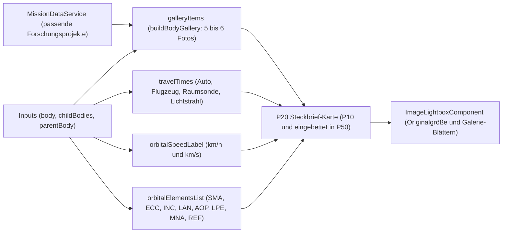

# Modul P20 – Detail-Steckbrief und die 7 Bahnelemente (`src/app/features/solar-system-view/infobox-detail`)

Zurück zur [Haupt-Übersicht](../../../../../README.md) · Übergeordnetes Modul [P10 Sternenkarte](../README.md).

Das Modul **P20** stellt alle wissenswerten Details zu jedem der **118 Einträge** des Sonnensystems kindgerecht zusammen – vom Foto-Karussell und Entdecker-Vergleichen ganz oben bis zur ausklappbaren **Astronomen-Box** mit allen **7 Bahnelementen** (`SMA` bis `REF` plus `AOP`) und offiziellen Quellenlinks unten. Die Komponente wird sowohl in **P10** (`/solar-system/:bodyId`) als auch direkt eingebettet im Weltraum-Quiz (**P50**) wiederverwendet.

## Inhaltsverzeichnis

1. [Datenfluss und Darstellung](#1-datenfluss-und-darstellung)
2. [Dateistruktur](#2-dateistruktur)
3. [Datenherkunft und Datenquellen](#3-datenherkunft-und-datenquellen)
4. [Kernfunktionen und FCPP-Zuordnung](#4-kernfunktionen-und-fcpp-zuordnung)
5. [Technische Detailerklärungen und Codebeispiele](#5-technische-detailerklärungen-und-codebeispiele)
   - [5.1 Kindgerechter Reisezeit-Vergleich](#51-kindgerechter-reisezeit-vergleich)
   - [5.2 Sub-Kilometer-Einheiten und Bahngeschwindigkeit](#52-sub-kilometer-einheiten-und-bahngeschwindigkeit)
   - [5.3 Retrograd-korrektes Argument der Periapsis und Mobile-Cards](#53-retrograd-korrektes-argument-der-periapsis-und-mobile-cards)
   - [5.4 Wiederverwendung als Standalone-Komponente in P10 und P50](#54-wiederverwendung-als-standalone-komponente-in-p10-und-p50)
6. [Tests und Verifizierung](#6-tests-und-verifizierung)
7. [KI-Transparenz](#7-ki-transparenz)

## 1. Datenfluss und Darstellung



## 2. Dateistruktur

| Datei | Aufgabe | FCPP-Bezug |
| :--- | :--- | :--- |
| [`infobox-detail.ts`](./infobox-detail.ts) | Standalone-Komponente (`InfoboxDetailComponent`) mit Inline-Template/Styles, Fotogalerie, Reisezeit-Berechnung, `formatSubKmDiameter`, Bahngeschwindigkeit, `aopElement` und 7-Bahnelemente-Tabelle | `P20-U10` bis `P20-U40` |

## 3. Datenherkunft und Datenquellen

| Inhalt im Steckbrief | Datenquelle | Verhalten im Offline-Betrieb |
| :--- | :--- | :--- |
| **Objekt-Stammdaten, `7` Bahnelemente, Fakten & Links** | Per Signal-Input (`body`, `childBodies`, `parentBody`) aus [`public/assets/data/solar-system-fallback.json`](../../../../../public/assets/data/solar-system-fallback.json) über `SolarSystemDataService` (Durchmesser ggf. mit Live-Update aus OpenData-API) | Zu 100 % aus dem lokalen JSON-Katalog bedient |
| **Mini-Galerie (`5`–`6` Fotos je Objekt)** | `buildBodyGallery()` in [`media-gallery.data.ts`](../../../core/data/media-gallery.data.ts) mit verifizierten Wikimedia-Commons- und NASA-Image-Library-URLs | Fehlerhafte/unerreichbare Fotos oder Thumbnails werden ausgeblendet; lokale Kategorie-SVGs unter `public/assets/images/` bleiben verfügbar |
| **Verknüpfte Forschungsprojekte** | [`public/assets/data/missions.json`](../../../../../public/assets/data/missions.json) via `MissionDataService.missions` | Rein lokales Asset unter `assets/data/missions.json` |
| **Reisezeiten, Bahntempo & `AOP`** | Rein clientseitige Ableitung per `computed()` aus `distanceFromEarthKm`, `orbitalPeriodDays`, `lan` und `lpe` | Vollständig offline ohne API-Aufruf |

## 4. Kernfunktionen und FCPP-Zuordnung

- **Didaktischer Aufbau „Kinder oben zu Profi unten“ (`P20-U10` bis `P20-U30`):** Oben stehen Titelbild, umschaltbare Mini-Galerie (`>= 5` HTTP-200-geprüfte Fotos aus [`media-gallery.data.ts`](../../../core/data/media-gallery.data.ts)), Originalgröße-Lightbox, Kurzbeschreibung, Größenhinweis, *Fun Facts* sowie anklickbare Chips für Monde, Raumsonden, Lagrange-Punkte (`childBodies`) und passende `P40`-Forschungsprojekte.
- **Kindgerechter Reisezeit-Vergleich (`travelTimes`):** Berechnet aus `distanceFromEarthKm` die ununterbrochene Reisezeit ab der Erde für **Auto** (`100 km/h`), **Flugzeug** (`900 km/h`), **Raumsonde** (`60.000 km/h`) und **Lichtstrahl** (`300.000 km/s`, z. B. `8 Min. 19 Sek.` zur Sonne).
- **Präzise Maße auch für Kleinstsatelliten (`formatSubKmDiameter`):** Durchmesser unter `1 km` werden automatisch in Zentimeter oder Meter dargestellt (z. B. *Vanguard 1*: `16,5 cm`, *Sputnik 1*: `60 cm`, *ISS*: `109 m`).
- **Astronomen-Box und Glossar-Tooltips (`P20-U20`, `P20-U40`):** Ausklappbare Responsive-Tabelle (Mobile-Karten ab `<= 720 px`) für `SMA`, `ECC`, `INC`, `LAN`, `AOP` (`(LPE - LAN) mod 360°` bzw. retrograd `LAN - LPE`), `LPE`, `MNA` und `REF`, kombiniert mit [`GlossaryTermComponent`](../../../shared/README.md) sowie Links zu offiziellen NASA-/ESA-Seiten, Wikipedia und Wikimedia Commons.

## 5. Technische Detailerklärungen und Codebeispiele

### 5.1 Kindgerechter Reisezeit-Vergleich

Damit sich Grundschulkinder gewaltige Entfernungen wie *149,6 Mio. km* (Sonne) oder *4,5 Mrd. km* (Neptun) anschaulich vorstellen können, leitet `travelTimes` in [`infobox-detail.ts`](./infobox-detail.ts) aus `distanceFromEarthKm` vier Vergleichsreisen ab. Für die Erde selbst (`b.id === 'earth'`) liefert das Computed-Signal ein leeres Array, sodass die Box dort ausgeblendet bleibt. Die Hilfsfunktion `formatTravelDuration(seconds)` skaliert über acht Zeitbereiche von `unter 0,1 Sekunden` bis `Mrd. Jahre` in deutscher Zahlenformatierung:

```typescript
// Ausschnitt aus src/app/features/solar-system-view/infobox-detail/infobox-detail.ts (Zeilen 29–74 & 998–1034)
function formatTravelDuration(seconds: number): string {
  if (!Number.isFinite(seconds) || seconds < 0.05) {
    return 'unter 0,1 Sekunden';
  }
  if (seconds < 60) {
    return seconds < 10
      ? `${seconds.toFixed(1).replace('.', ',')} Sekunden`
      : `${Math.round(seconds)} Sekunden`;
  }
  if (seconds < 3600) {
    const mins = Math.floor(seconds / 60);
    const remSec = Math.round(seconds - mins * 60);
    if (remSec === 60) {
      return `${mins + 1} Minuten`;
    }
    if (mins < 15 && remSec > 0) {
      return `${mins} Min. ${remSec} Sek.`;
    }
    return `${Math.round(seconds / 60)} Minuten`;
  }
  const hours = seconds / 3600;
  if (hours < 48) {
    return hours < 10
      ? `${hours.toFixed(1).replace('.', ',')} Stunden`
      : `${Math.round(hours)} Stunden`;
  }
  const days = hours / 24;
  if (days < 365.25) {
    return days < 20
      ? `${days.toFixed(1).replace('.', ',')} Tage`
      : `${Math.round(days)} Tage`;
  }
  const years = days / 365.25;
  if (years < 100) {
    return `${years.toFixed(1).replace('.', ',')} Jahre`;
  }
  if (years < 1_000_000) {
    return `${Math.round(years).toLocaleString('de-DE')} Jahre`;
  }
  const mioYears = years / 1_000_000;
  if (mioYears < 1_000) {
    return `${mioYears.toFixed(1).replace('.', ',')} Mio. Jahre`;
  }
  const mrdYears = mioYears / 1_000;
  return `${Math.round(mrdYears).toLocaleString('de-DE')} Mrd. Jahre`;
}

readonly travelTimes = computed<TravelTimeComparison[]>(() => {
  const b = this.body();
  if (!b || b.id === 'earth' || b.distanceFromEarthKm <= 0) {
    return [];
  }
  const km = b.distanceFromEarthKm;
  return [
    {
      id: 'auto',
      label: 'Auto',
      speedLabel: '100 km/h',
      icon: 'fa-solid fa-car-side',
      durationLabel: formatTravelDuration((km / 100) * 3600),
    },
    {
      id: 'plane',
      label: 'Flugzeug',
      speedLabel: '900 km/h',
      icon: 'fa-solid fa-plane',
      durationLabel: formatTravelDuration((km / 900) * 3600),
    },
    {
      id: 'probe',
      label: 'Raumsonde',
      speedLabel: '60.000 km/h',
      icon: 'fa-solid fa-rocket',
      durationLabel: formatTravelDuration((km / 60000) * 3600),
    },
    {
      id: 'light',
      label: 'Lichtstrahl',
      speedLabel: '300.000 km/s',
      icon: 'fa-solid fa-bolt',
      durationLabel: formatTravelDuration(km / 299792.458),
    },
  ];
});
```

### 5.2 Sub-Kilometer-Einheiten und Bahngeschwindigkeit

Kleine Sonden und Satelliten würden als reine Kilometerzahl (`0.000165 km` bei **Vanguard 1**) für Kinder unleserlich wirken. `formatSubKmDiameter()` rechnet Werte unter `0.001 km` in Zentimeter (`16,5 cm`) und unter `1 km` in Meter (`109 m`) um. Parallel berechnet `orbitalSpeedLabel` die mittlere Bahngeschwindigkeit aus dem Bahn­umfang $2 \pi \cdot a \cdot 149\,597\,870{,}7\,\text{km}$ dividiert durch `orbitalPeriodDays * 24` in `km/h` und `km/s` und behandelt hyperbolische Fluchtsonden (*Voyager 1/2*, *New Horizons*, *Parker*) sowie gelandete Rover (`isSurfaceLanded`: `0 km/h`) gesondert:

```typescript
// Ausschnitt aus src/app/features/solar-system-view/infobox-detail/infobox-detail.ts (Zeilen 1037–1083 & 1118–1125)
readonly orbitalSpeedLabel = computed<string>(() => {
  const b = this.body();
  if (!b) {
    return '–';
  }
  if (b.id === 'sun') {
    return 'ca. 828.000 km/h (durch die Milchstraße)';
  }
  if (b.id === 'voyager-1') {
    return 'ca. 61.200 km/h (17,0 km/s)';
  }
  if (b.id === 'voyager-2') {
    return 'ca. 55.400 km/h (15,4 km/s)';
  }
  if (b.id === 'new-horizons') {
    return 'ca. 49.500 km/h (13,8 km/s)';
  }
  if (b.id === 'parker') {
    return 'bis zu 692.000 km/h (192 km/s)';
  }
  if (b.isSurfaceLanded) {
    return '0 km/h (auf der Oberfläche gelandet)';
  }
  if (b.id === 'iss') {
    return 'ca. 27.600 km/h (7,66 km/s)';
  }
  if (b.id === 'hubble') {
    return 'ca. 27.300 km/h (7,59 km/s)';
  }
  const smaAu = b.orbitalElements.sma.numericValue ?? b.distanceFromSunAu;
  if (smaAu > 0 && b.orbitalPeriodDays > 0) {
    const kmPerAu = 149597870.7;
    const circumferenceKm = 2 * Math.PI * smaAu * kmPerAu;
    const kmPerHour = circumferenceKm / (b.orbitalPeriodDays * 24);
    const kmPerSec = kmPerHour / 3600;
    const formattedKmh =
      kmPerHour >= 100
        ? Math.round(kmPerHour).toLocaleString('de-DE')
        : kmPerHour.toFixed(1).replace('.', ',');
    const formattedKms =
      kmPerSec >= 10
        ? kmPerSec.toFixed(1).replace('.', ',')
        : kmPerSec.toFixed(2).replace('.', ',');
    return `ca. ${formattedKmh} km/h (${formattedKms} km/s)`;
  }
  return '–';
});

formatSubKmDiameter(diameterKm: number): string {
  if (diameterKm < 0.001) {
    const cm = Number((diameterKm * 100_000).toFixed(1));
    return `${cm.toLocaleString('de-DE', { maximumFractionDigits: 1 })} cm`;
  }
  const meters = Number((diameterKm * 1_000).toFixed(1));
  return `${meters.toLocaleString('de-DE', { maximumFractionDigits: 1 })} m`;
}
```

### 5.3 Retrograd-korrektes Argument der Periapsis und Mobile-Cards

Da die JSON-Datensätze `LPE` ($\varpi$) und `LAN` ($\Omega$) liefern, leitet `aopElement` das Argument der Periapsis ($\omega$) dynamisch her. Bei **retrograden Umlaufbahnen** (`inclinationToSolarEquatorDeg > 90`, etwa *1P/Halley*, *NEOWISE* oder *Triton*) gilt $\varpi = \Omega - \omega$, weshalb `rawOmega = lan - lpe` statt `lpe - lan` gerechnet werden muss. Damit alle acht Elemente auch auf schmalen Smartphones ohne horizontales Scrollen lesbar bleiben, wandelt das CSS ab `max-width: 720px` jede `<tr>`-Zeile in eine kompakte Karte um:

```typescript
// Ausschnitt aus src/app/features/solar-system-view/infobox-detail/infobox-detail.ts (Zeilen 948–976)
readonly aopElement = computed<OrbitalElementDetail>(() => {
  const b = this.body();
  if (!b) {
    return {
      code: 'AOP',
      label: 'Argument der Periapsis',
      formattedValue: '–',
      childExplanation: '',
    };
  }
  if (b.orbitalElements.aop) {
    return b.orbitalElements.aop;
  }
  const lpe = b.orbitalElements.lpe.numericValue;
  const lan = b.orbitalElements.lan.numericValue;
  if (lpe !== undefined && lan !== undefined) {
    const isRetro = b.inclinationToSolarEquatorDeg > 90;
    const rawOmega = isRetro ? lan - lpe : lpe - lan;
    const omega = Number((((rawOmega % 360) + 360) % 360).toFixed(2));
    return {
      code: 'AOP',
      label: 'Argument der Periapsis',
      formattedValue: `${omega}°`,
      numericValue: omega,
      unit: '°',
      childExplanation:
        'Der Winkel vom aufsteigenden Knoten (LAN) entlang der Bahn bis zum sonnennächsten Punkt (Periapsis).',
    };
  }
```

```css
/* Ausschnitt aus src/app/features/solar-system-view/infobox-detail/infobox-detail.ts (Zeilen 847–898) */
@media (max-width: 720px) {
  .orbital-table thead {
    display: none;
  }
  .orbital-table,
  .orbital-table tbody,
  .orbital-table tr,
  .orbital-table td {
    display: block;
    width: 100%;
  }
  .orbital-table tr {
    margin-bottom: 0.65rem;
    border: 1px solid var(--card-border);
    border-radius: var(--radius-md);
    background-color: var(--card-bg-elevated);
    padding: 0.45rem 0.6rem;
  }
  .orbital-table td.code-cell,
  .orbital-table td.name-cell {
    display: inline-block;
    width: auto;
  }
}
```

### 5.4 Wiederverwendung als Standalone-Komponente in P10 und P50

Durch reine Signal-Inputs (`body`, `childBodies`, `parentBody`) und Outputs (`bodySelected`, `closed`) besitzt `InfoboxDetailComponent` keine harte Kopplung an den Angular Router. In [`solar-system-view.html`](../solar-system-view.html) navigiert `(bodySelected)` zu `/solar-system/:id`; im Quiz ([`space-quiz.html`](../../space-quiz/space-quiz.html)) aktualisiert dasselbe Event nur das lokale Signal `previewBodyId`, sodass Kinder verwandte Monde anschauen können, ohne ihre aktuelle Quiz-Runde zu verlieren:

```html
<!-- Einbettung in src/app/features/solar-system-view/solar-system-view.html (Zeilen 713–720) -->
@if (dataService.selectedBody(); as activeBody) {
  <app-infobox-detail
    [body]="activeBody"
    [childBodies]="dataService.selectedBodyChildren()"
    [parentBody]="selectedParentBody()"
    (bodySelected)="onSelectBody($event)"
    (closed)="onCloseInfobox()"
  />
}
```

## 6. Tests und Verifizierung

Die Komponente wird gemeinsam über die Integrationstests in [`solar-system-view.spec.ts`](../solar-system-view.spec.ts) (`P10`/`P20`) und [`space-quiz.spec.ts`](../../space-quiz/space-quiz.spec.ts) (`P50`-Steckbrief-Einbettung) verifiziert:

- Anzeige aller 7+ Bahnelemente (`SMA`–`REF` + `AOP`), mindestens `5` Mini-Galerie-Thumbnails sowie offizieller Quellenlinks.
- Kindgerechter Reisezeit-Vergleich für Himmelskörper außerhalb der Erde (z. B. Sonne: `8 Min. 19 Sek.`) und Ausblendung bei Auswahl der Erde.

## 7. KI-Transparenz

Die vollständige Kennzeichnung des KI-Umfangs befindet sich im Datei-Header von [`infobox-detail.ts`](./infobox-detail.ts) sowie im [`AI-LOG.md`](../../../../../AI-LOG.md).
