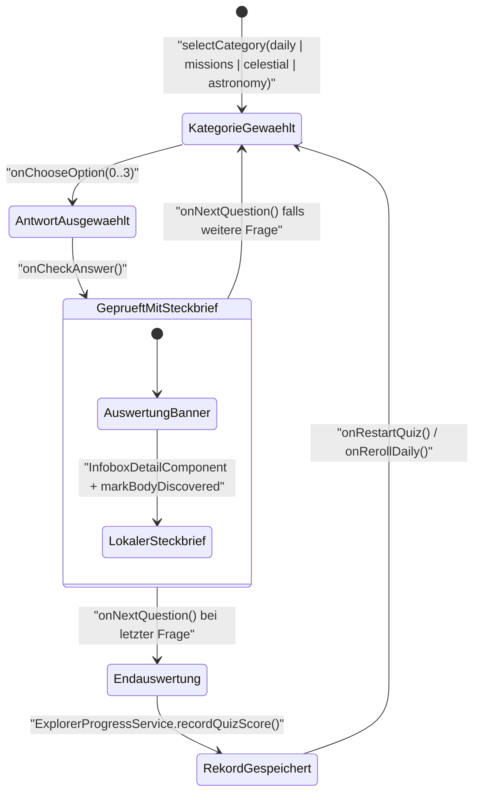

# Modul P50 – Weltraum-Quiz, Entdecker-Pass und Auswertung (`src/app/features/space-quiz`)

Zurück zur [Haupt-Übersicht](../../../../README.md).

Das Modul **P50** setzt das interaktive **Weltraum-Quiz** für Grundschulkinder um. Es verbindet **42 Quizfragen in 4 Kategorien** (inklusive zufällig gemischtem *Quiz des Tages*), direkte fachliche Rückmeldungen mit **sofort eingebettetem P20-Bild-Steckbrief**, einer motivierenden Astronauten-Auswertung sowie offline-fähigen **Kategorie-Bestwerten** und dem **Entdecker-Pass**.

## Inhaltsverzeichnis

1. [Quiz-Lebenszyklus als Zustandsdiagramm](#1-quiz-lebenszyklus-als-zustandsdiagramm)
2. [Dateistruktur](#2-dateistruktur)
3. [Datenherkunft und Datenquellen](#3-datenherkunft-und-datenquellen)
4. [Kernfunktionen und FCPP-Zuordnung](#4-kernfunktionen-und-fcpp-zuordnung)
5. [Technische Detailerklärungen und Codebeispiele](#5-technische-detailerklärungen-und-codebeispiele)
   - [5.1 Fisher-Yates-Zufallswähler und Signal-Quiz-Engine](#51-fisher-yates-zufallswähler-und-signal-quiz-engine)
   - [5.2 Kindgerechte Fehlerkorrektur ohne Lobwörter](#52-kindgerechte-fehlerkorrektur-ohne-lobwörter)
   - [5.3 Lokale P20-Steckbrief-Vorschau und Entdecker-Pass-Synchronisation](#53-lokale-p20-steckbrief-vorschau-und-entdecker-pass-synchronisation)
6. [Tests und Verifizierung](#6-tests-und-verifizierung)
7. [KI-Transparenz](#7-ki-transparenz)

## 1. Quiz-Lebenszyklus als Zustandsdiagramm



## 2. Dateistruktur

| Datei | Aufgabe | FCPP-Bezug |
| :--- | :--- | :--- |
| [`space-quiz.ts`](./space-quiz.ts) | Signal-Steuerung für Kategoriewahl, Antwortprüfung, `getFormattedExplanation`, lokalen P20-Steckbrief und Entdecker-Pass-Fortschritt | `P50-U10` bis `P50-U30` |
| [`space-quiz.html`](./space-quiz.html) | Zweispaltiges Quiz-Layout mit Kategorien und Bestwerten links, Frage/Optionen A–D, Sofort-Steckbrief und Auswertungskarte | `P50-U10` bis `P50-U30` |
| [`space-quiz.css`](./space-quiz.css) | Tag-/Nachtmodus-kompatible Quiz-Karten, Bestwert-/Rekord-Badges, Fortschrittsbalken und Responsive-Grid (`<= 860px`) | `P50-U10` bis `P50-U30` |
| [`space-quiz.spec.ts`](./space-quiz.spec.ts) | Integrationstest für Kategoriewahl, Antwortprüfung, Steckbrief-Einbindung, Korrekturtexte, Rekord-Badge und Entdecker-Pass | `P50-U20`, `P50-U30` |

## 3. Datenherkunft und Datenquellen

| Datenbereich | Quelle | Beschreibung |
| :--- | :--- | :--- |
| **`42` Quizfragen in `4` Kategorien** | [`public/assets/data/quiz-questions.json`](../../../../public/assets/data/quiz-questions.json) (`QuizService`) | Rein lokales Asset (`assets/data/quiz-questions.json`), vollständig offline verfügbar |
| **Eingebetteter Sofort-Steckbrief (`P20`)** | [`public/assets/data/solar-system-fallback.json`](../../../../public/assets/data/solar-system-fallback.json) über `SolarSystemDataService` | Löst `question.relatedBodyId` lokal auf den passenden Himmelskörper bzw. das Raumfahrzeug auf (inkl. Galeriefotos & verknüpfter Missionen) |
| **Bestwerte & Entdecker-Pass** | Browser-`localStorage` ([`ExplorerProgressService`](../../core/README.md#54-robuste-localstorage-persistenz-im-entdecker-pass)) | Speichert Kategorie-Bestwerte (`ssi_app_quiz_best_scores_v1`) und entdeckte Objekte (`ssi_app_discovered_bodies_v1`) ohne Server |

## 4. Kernfunktionen und FCPP-Zuordnung

- **4 Kategorien aus 42 Fragen (`P50-U30`):** *Quiz des Tages* (7 Fragen via Fisher-Yates-Shuffle *„Fragen neu würfeln“*), *Missionsquiz* (inkl. Fragen zu *Gemini 4/8*, *Apollo 8*, *ESA Giotto*, *ESA Mars Express* und *Vanguard 1*), *Raumkörperquiz* sowie *Bahnen, Kometen und Rekorde* (inkl. *NEOWISE* und Bahnelementen `SMA`–`REF`).
- **Kindgerechte Fehlerkorrektur und Sofort-Steckbrief (`P50-U20`):** `getFormattedExplanation` entfernt bei falscher Antwort automatisch einleitende Lobwörter (*„Genau!“*, *„Richtig!“*) und nennt den korrekten Buchstaben; parallel öffnet sich darunter die eingebettete [`InfoboxDetailComponent`](../solar-system-view/infobox-detail/README.md) des `relatedBodyId`-Himmelskörpers.
- **Lokaler Entdecker-Pass und Bestwerte (`ExplorerProgressService`):** Jede über den Quiz-Steckbrief betrachtete Welt wird automatisch im Entdecker-Pass gezählt (`discoveredCatalogCount() / totalCatalogCount()`), und am Ende jeder Runde wird der persönliche Bestwert in `localStorage` gespeichert (`recordQuizScore`).

## 5. Technische Detailerklärungen und Codebeispiele

### 5.1 Fisher-Yates-Zufallswähler und Signal-Quiz-Engine

[`QuizService`](../../core/services/quiz.service.ts) entkoppelt Zustand und UI vollständig über Signale. Für das **„Quiz des Tages“** (`daily`) mischt `shuffleDailyQuestions()` eine Kopie aller `42` Fragen mithilfe des unverzerrten **Fisher-Yates-Verfahrens** ($O(n)$, jede Permutation gleich wahrscheinlich) und wählt davon `dailyQuestionCount = 7` Fragen aus. `checkCurrentAnswer()` schützt vor Mehrfach-Klicks (`isAnswerChecked()`), während `nextQuestion()` nach der letzten Frage (`isLastQuestion()`) automatisch `explorerProgress.recordQuizScore()` aufruft und `isNewPersonalRecord` für die Auswertungskarte setzt:

```typescript
// Ausschnitt aus src/app/core/services/quiz.service.ts (Zeilen 139–200)
shuffleDailyQuestions(): void {
  const pool = [...this.allQuestionsState()];
  for (let i = pool.length - 1; i > 0; i--) {
    const j = Math.floor(Math.random() * (i + 1));
    [pool[i], pool[j]] = [pool[j], pool[i]];
  }
  this.dailyQuestionsState.set(pool.slice(0, Math.min(this.dailyQuestionCount, pool.length)));
}

chooseOption(optionIndex: number): void {
  if (this.isAnswerChecked()) {
    return;
  }
  this.selectedOptionIndex.set(optionIndex);
}

checkCurrentAnswer(): void {
  const question = this.currentQuestion();
  const chosen = this.selectedOptionIndex();
  if (!question || chosen === null || this.isAnswerChecked()) {
    return;
  }

  this.isAnswerChecked.set(true);
  if (chosen === question.correctOptionIndex) {
    this.scoreCorrect.update((c) => c + 1);
  } else {
    this.scoreWrong.update((w) => w + 1);
  }
}

nextQuestion(): void {
  if (!this.isAnswerChecked()) {
    return;
  }
  if (this.isLastQuestion()) {
    const isRecord = this.explorerProgress.recordQuizScore(
      this.selectedCategory(),
      this.scoreCorrect(),
      this.totalQuestions(),
    );
    this.isNewPersonalRecord.set(isRecord);
    this.isQuizFinished.set(true);
    return;
  }
  this.currentQuestionIndex.update((i) => i + 1);
  this.selectedOptionIndex.set(null);
  this.isAnswerChecked.set(false);
}
```

### 5.2 Kindgerechte Fehlerkorrektur ohne Lobwörter

Die Erklärungstexte in `public/assets/data/quiz-questions.json` beginnen häufig positiv mit Wörtern wie *„Richtig!“* oder *„Genau!“*. Würde derselbe Text unverändert nach einer **falschen** Schülerantwort erscheinen, entstünde ein verwirrender Widerspruch. `getFormattedExplanation()` in [`space-quiz.ts`](./space-quiz.ts) bereinigt deshalb bei Falschantworten per regulärem Ausdruck einleitende Lobwörter und setzt eine ermutigende Rückmeldung inklusive des gesuchten Buchstabens (`A`–`D`) voran:

```typescript
// Ausschnitt aus src/app/features/space-quiz/space-quiz.ts (Zeilen 132–141)
getFormattedExplanation(q: QuizQuestion): string {
  if (this.quizService.selectedOptionIndex() === q.correctOptionIndex) {
    return q.childExplanation;
  }
  const cleanText = q.childExplanation
    .replace(/^(?:Richtig|Genau|Super|Stark|Klasse|Volltreffer|Spitze|Stimmt)!\s*/i, '')
    .trim();
  const correctLetter = this.optionLetters[q.correctOptionIndex] ?? '';
  return `Schade, nicht ganz! Richtig ist Antwort ${correctLetter}: ${cleanText}`;
}
```

### 5.3 Lokale P20-Steckbrief-Vorschau und Entdecker-Pass-Synchronisation

Statt beim Prüfen einer Antwort die Quiz-Route zu verlassen, bindet [`SpaceQuizComponent`](./space-quiz.ts) die Komponente [`InfoboxDetailComponent`](../solar-system-view/infobox-detail/README.md) lokal ein. Über `previewBodyId` als lokales Signal bleiben Quiz-Stand, Punktestand und Fragenindex jederzeit erhalten – auch wenn das Kind im eingebetteten Steckbrief auf zugehörige Monde klickt (`onSelectSteckbriefBody`). Sowohl das Prüfen der Antwort (`onCheckAnswer`) als auch der Weiterklick auf Monde tragen das jeweilige Objekt sofort über `explorerProgress.markBodyDiscovered()` in den lokalen Entdecker-Pass ein:

```typescript
// Ausschnitt aus src/app/features/space-quiz/space-quiz.ts (Zeilen 47–57 & 99–125)
readonly previewBodyId = signal<string | null>(null);
readonly isSteckbriefOpen = signal<boolean>(true);

readonly activeSteckbriefBody = computed<CelestialBody | null>(() => {
  const targetId = this.previewBodyId() ?? this.quizService.currentQuestion()?.relatedBodyId;
  if (!targetId) {
    return null;
  }
  return this.solarDataService.bodies().find((b) => b.id === targetId) ?? null;
});

onCheckAnswer(): void {
  const relatedId = this.quizService.currentQuestion()?.relatedBodyId ?? null;
  this.previewBodyId.set(relatedId);
  this.isSteckbriefOpen.set(true);
  this.quizService.checkCurrentAnswer();
  if (relatedId) {
    this.explorerProgress.markBodyDiscovered(relatedId);
  }
}

onSelectSteckbriefBody(bodyId: string): void {
  this.previewBodyId.set(bodyId);
  this.isSteckbriefOpen.set(true);
  this.explorerProgress.markBodyDiscovered(bodyId);
}
```

```html
<!-- Lokale Steckbrief-Einbindung in src/app/features/space-quiz/space-quiz.html (Zeilen 171–181) -->
@if (quizService.isAnswerChecked() && isSteckbriefOpen() && activeSteckbriefBody(); as body) {
  <div class="quiz-local-steckbrief-wrapper">
    <app-infobox-detail
      [body]="body"
      [childBodies]="activeSteckbriefChildren()"
      [parentBody]="activeSteckbriefParent()"
      (bodySelected)="onSelectSteckbriefBody($event)"
      (closed)="isSteckbriefOpen.set(false)"
    />
  </div>
}
```

## 6. Tests und Verifizierung

[`space-quiz.spec.ts`](./space-quiz.spec.ts) (`1` Integrationstest) prüft:

- Anzeige aller 4 Quiz-Kategorien und des Buttons *„Fragen neu würfeln“*.
- Auswahl einer Kategorie, Prüfen einer richtigen Antwort inklusive eingebettetem Mars-Steckbrief und Quellenlinks.
- Abschluss der Runde mit Anzeige des Rekord-Badges (*„Neuer persönlicher Bestwert gespeichert!“*), Kategorie-Bestwert (`1 / 1`) und Entdecker-Pass-Stand (`1 / 1 entdeckt`).
- Korrekte Umformulierung einer falschen Antwort ohne einleitende Lobwörter.

## 7. KI-Transparenz

Alle Dateien dieses Moduls dokumentieren den KI-Anteil im Datei-Header gemäß `.agents/AGENTS.md` sowie im [`AI-LOG.md`](../../../../AI-LOG.md).
