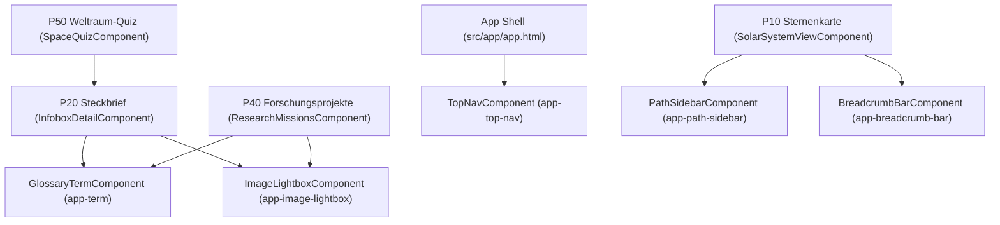

# Shared-Modul – Wiederverwendbare UI-Komponenten (`src/app/shared`)

Zurück zur [Haupt-Übersicht](../../../README.md).

Das Shared-Modul bündelt fünf eigenständige **Angular-22-Standalone-Komponenten** für Navigation, hierarchische Pfad-Auswahl, Fachbegriff-Erklärungen und Bildbetrachtung, die modulübergreifend in der App-Shell sowie in `P10` bis `P50` eingesetzt werden.

## Inhaltsverzeichnis

1. [Komponenten-Einsatz in der Anwendung](#1-komponenten-einsatz-in-der-anwendung)
2. [Dateistruktur](#2-dateistruktur)
3. [Komponenten und Schnittstellen](#3-komponenten-und-schnittstellen)
4. [Technische Detailerklärungen und Codebeispiele](#4-technische-detailerklärungen-und-codebeispiele)
   - [4.1 Rekursiver Entdecker-Pfad mit Live-Suche und Fortschrittsbalken](#41-rekursiver-entdecker-pfad-mit-live-suche-und-fortschrittsbalken)
   - [4.2 Modale Galerie-Lightbox mit Zoom und Tastatursteuerung](#42-modale-galerie-lightbox-mit-zoom-und-tastatursteuerung)
   - [4.3 Barrierearme Inline-Glossar-Tooltips](#43-barrierearme-inline-glossar-tooltips)
   - [4.4 Top-Navigation, Tag-/Nachtmodus und Breadcrumb-Leiste](#44-top-navigation-tag-nachtmodus-und-breadcrumb-leiste)
5. [Tests und Verifizierung](#5-tests-und-verifizierung)
6. [KI-Transparenz](#6-ki-transparenz)

## 1. Komponenten-Einsatz in der Anwendung



## 2. Dateistruktur

| Pfad | Selector | Aufgabe | FCPP-Bezug |
| :--- | :--- | :--- | :--- |
| [`components/top-nav/`](./components/top-nav/top-nav.ts) | `app-top-nav` | Fixierte Hauptnavigation (`P10`–`P50`), Brand-Link zur Startseite (`/`) und Tag-/Nachtmodus-Schalter (`ThemeService`) | `P10-U10` bis `P50-U10` |
| [`components/path-sidebar/path-sidebar.ts`](./components/path-sidebar/path-sidebar.ts) | `app-path-sidebar` | Rekursive Tree-Navigation links mit Live-Schnellsuche (`118` Einträge) und Entdecker-Pass-Fortschritt | `P10-U20`, `P20-U10` |
| [`components/breadcrumb-bar/breadcrumb-bar.ts`](./components/breadcrumb-bar/breadcrumb-bar.ts) | `app-breadcrumb-bar` | Klickbare Pfad-Leiste vom Sonnensystem bis zum ausgewählten Mond oder Lagrange-Punkt | `P10-U20` |
| [`components/image-lightbox/image-lightbox.ts`](./components/image-lightbox/image-lightbox.ts) | `app-image-lightbox` | Modale Großansicht ohne `#000000` mit Stufen-Zoom (`50 %`–`350 %`), Galerie-Pfeilen, Tastatursteuerung (`Escape` / Pfeiltasten) und Thumbnails | `P20-U20`, `P40-U20` |
| [`components/glossary-term/glossary-term.ts`](./components/glossary-term/glossary-term.ts) | `app-term` | Kindgerechte Hover-/Fokus-Tooltips für `21` Astronomie- und Raumfahrt-Fachbegriffe (`GLOSSARY_DEFINITIONS`) | `P10`, `P20`, `P40` |

## 3. Komponenten und Schnittstellen

| Komponente | Inputs (`input()`) | Outputs (`output()`) | Besonderheiten |
| :--- | :--- | :--- | :--- |
| `TopNavComponent` | – (nutzt `ThemeService` und Router) | – | Sticky-Leiste, aktive Routenmarkierung (`RouterLinkActive`) |
| `PathSidebarComponent` | `nodes`, `activeBodyId`, `isRoot`, `discoveredBodyIds`, `discoveredCount`, `totalBodiesCount`, `forceExpandAll` | `bodySelected` | Rekursive Baum-Filterung (`filterTreeNodes`) + Auto-Expand bei aktiver Suche |
| `BreadcrumbBarComponent` | `items` (`BreadcrumbItem[]`) | `crumbSelected` | Sprung zu `Sonnensystem` (`null`) oder jedem übergeordneten `bodyId` |
| `ImageLightboxComponent` | `isOpen`, `imageSrc`, `fallbackSrc`, `title`, `credit`, `galleryItems` | `closed`, `imageSelected` | Bildzähler (`Bild X von Y`), Mausrad-Zoom, Offline-SVG-Fallback |
| `GlossaryTermComponent` | `term` (Pflicht), `label` (optional) | – | Kontraststarker Dunkelblau-Tooltip (`#111D3B`) per Hover und Fokus |

> **Hinweis zur Datenherkunft:** Alle Shared-Komponenten arbeiten zustandslos über Angular `input()`-Signale des aufrufenden Moduls – einzige Ausnahmen sind die statischen `21` Begriffserklärungen (`GLOSSARY_DEFINITIONS`) in `GlossaryTermComponent` sowie der Tag-/Nachtmodus (`localStorage`-Schlüssel `ssi-app-theme`) über `ThemeService` in `TopNavComponent`.

## 4. Technische Detailerklärungen und Codebeispiele

### 4.1 Rekursiver Entdecker-Pfad mit Live-Suche und Fortschrittsbalken

[`PathSidebarComponent`](./components/path-sidebar/path-sidebar.ts) bindet sich selbst über `imports: [PathSidebarComponent]` rekursiv ein (`isRoot() === false` für Unterebenen). Damit der gesamte Eltern-Pfad (*Sonnensystem → Planeten → Erde → Erdmond / Vanguard 1*) sichtbar bleibt, sobald ein Kindknoten auf das Suchwort passt, prüft `filterTreeNodes()` jeden Knoten zweistufig:

- **Direkter Treffer (`directMatch`):** Passt der Name (`node.label`) oder die ID (`node.bodyId`), bleibt der Knoten samt gefilterter Kinder oder – falls nur der Gruppenname getroffen wurde – aller seiner Unterknoten sichtbar.
- **Indirekter Treffer (`filteredChildren.length > 0`):** Trifft die Suche erst tief im Teilbaum zu, wird der Elternknoten automatisch mit seinen gefilterten Ästen weitergereicht und über `effectiveForceExpand()` aufgeklappt.
- **Dublettenfreie Trefferzählung:** `collectUniqueBodyIds()` sammelt gefundene `bodyId`-Werte in einem `Set<string>`, weil manche Objekte (z. B. Raumsonden) im Baum sowohl unter ihrem Zielplaneten als auch in der Sonden-Gruppe auftauchen.

```typescript
// Ausschnitt aus src/app/shared/components/path-sidebar/path-sidebar.ts (Zeilen 14–47)
function filterTreeNodes(nodes: PathTreeNode[], queryLower: string): PathTreeNode[] {
  const result: PathTreeNode[] = [];
  for (const node of nodes) {
    const labelMatch = node.label.toLowerCase().includes(queryLower);
    const idMatch = node.bodyId?.toLowerCase().includes(queryLower) ?? false;
    const directMatch = labelMatch || idMatch;
    const filteredChildren = node.children ? filterTreeNodes(node.children, queryLower) : [];

    if (directMatch) {
      result.push({
        ...node,
        children: filteredChildren.length > 0 ? filteredChildren : node.children,
      });
    } else if (filteredChildren.length > 0) {
      result.push({
        ...node,
        children: filteredChildren,
      });
    }
  }
  return result;
}

function collectUniqueBodyIds(nodes: PathTreeNode[], collector: Set<string>): void {
  for (const node of nodes) {
    if (node.bodyId) {
      collector.add(node.bodyId);
    }
    if (node.children) {
      collectUniqueBodyIds(node.children, collector);
    }
  }
}
```

Im Inline-Template übergibt jede aufgeklappte Ebene den aktuellen Filter- und Entdecker-Pass-Zustand an die nächste Rekursionsstufe (`[isRoot]="false"`):

```html
<!-- Rekursiver Selbstaufruf im Template von PathSidebarComponent (Zeilen 157–166) -->
@if (node.children && node.children.length > 0 && isExpanded(node.id)) {
  <app-path-sidebar
    [nodes]="node.children"
    [activeBodyId]="activeBodyId()"
    [discoveredBodyIds]="discoveredBodyIds()"
    [forceExpandAll]="effectiveForceExpand()"
    [isRoot]="false"
    (bodySelected)="bodySelected.emit($event)"
  />
}
```

### 4.2 Modale Galerie-Lightbox mit Zoom und Tastatursteuerung

[`ImageLightboxComponent`](./components/image-lightbox/image-lightbox.ts) synchronisiert beim Öffnen per `effect()` das aktive Bild (`activeSrc`) mit dem Input `imageSrc` und setzt den Zoomfaktor auf `1.0` (`100 %`) zurück.

Die Navigation innerhalb der 5–6 Galerie-Bilder erfolgt über `currentIndex` (Computed-Signal auf `galleryItems`) und zyklische Modulo-Arithmetik in `prevImage()` bzw. `nextImage()` – ohne den Dialog schließen zu müssen. Jede Auswahl sendet `imageSelected` an die Elternkomponente (`P20` oder `P40`), damit auch dort das gewählte Bild synchron bleibt. `@HostListener('document:keydown')` bindet `ArrowLeft`, `ArrowRight` und `Escape` global, solange `isOpen()` aktiv ist, während `background-color: rgba(11, 19, 43, 0.9)` strikt die Vorgabe „kein `#000000`“ einhält:

```typescript
// Ausschnitt aus src/app/shared/components/image-lightbox/image-lightbox.ts (Zeilen 320–382 & 421–433)
readonly currentIndex = computed<number>(() => {
  const items = this.galleryItems();
  const current = this.activeSrc() || this.imageSrc();
  const idx = items.findIndex((it) => it.url === current);
  return idx >= 0 ? idx : 0;
});

constructor() {
  effect(() => {
    if (this.isOpen()) {
      this.activeSrc.set(this.imageSrc() || this.fallbackSrc());
      this.zoomScale.set(1);
    }
  });
}

prevImage(): void {
  const items = this.galleryItems();
  if (items.length <= 1) {
    return;
  }
  const nextIdx = (this.currentIndex() - 1 + items.length) % items.length;
  this.selectGalleryItem(items[nextIdx].url);
}

nextImage(): void {
  const items = this.galleryItems();
  if (items.length <= 1) {
    return;
  }
  const nextIdx = (this.currentIndex() + 1) % items.length;
  this.selectGalleryItem(items[nextIdx].url);
}

selectGalleryItem(url: string): void {
  this.activeSrc.set(url);
  this.zoomScale.set(1);
  this.imageSelected.emit(url);
}

@HostListener('document:keydown', ['$event'])
onKeyDown(event: KeyboardEvent): void {
  if (!this.isOpen() || this.galleryItems().length <= 1) {
    return;
  }
  if (event.key === 'ArrowLeft') {
    event.preventDefault();
    this.prevImage();
  } else if (event.key === 'ArrowRight') {
    event.preventDefault();
    this.nextImage();
  }
}
```

### 4.3 Barrierearme Inline-Glossar-Tooltips

[`GlossaryTermComponent`](./components/glossary-term/glossary-term.ts) (`selector: 'app-term'`) erklärt Fachbegriffe aus der Astronomie und Raumfahrt direkt im Lesefluss. Die Definitionen liegen als schreibgeschützte Lookup-Tabelle `GLOSSARY_DEFINITIONS` (`21` Einträge von `AE` über `Exzentrizität` bis `Korona`) vor. Durch `tabindex="0"` und die CSS-Selektoren `.glossary-wrapper:hover` sowie `.glossary-wrapper:focus` öffnen sich die marineblauen Tooltips (`#111d3b`, `role="tooltip"`) sowohl per Mauszeiger als auch per Tastatur oder Touch. Über den optionalen Input `label` lässt sich der sichtbare Text im Satz unabhängig vom Glossar-Schlüssel beugen:

```typescript
// Ausschnitt aus src/app/shared/components/glossary-term/glossary-term.ts (Zeilen 103–113)
export class GlossaryTermComponent {
  readonly term = input.required<string>();
  readonly label = input<string>();

  protected readonly displayText = computed(() => this.label() || this.term());
  protected readonly explanation = computed(
    () =>
      GLOSSARY_DEFINITIONS[this.term()] ??
      'Ein Fachbegriff aus der Astronomie und Raumfahrt.',
  );
}
```

Beispiel für die Einbindung mit abweichendem Anzeigetext im Fließtext:

```html
<app-term term="Lagrange-Punkte" label="Lagrange-Punkt L2" />
```

### 4.4 Top-Navigation, Tag-/Nachtmodus und Breadcrumb-Leiste

[`TopNavComponent`](./components/top-nav/top-nav.ts) verwaltet die Hauptrouten in einem typisierten Array `navItems` inklusive zugeordneter Font-Awesome-Icons und `FCPP`-Referenz und injiziert [`ThemeService`](../core/services/theme.service.ts). Ein `effect()` im `ThemeService` hält den CSS-Klasse-Zustand `theme-dark` am `<body>` sowie den Schlüssel `ssi-app-theme` im `localStorage` automatisch synchron, sobald Kinder oben rechts den Button betätigen:

```typescript
// Ausschnitt aus src/app/core/services/theme.service.ts (Zeilen 15–37)
export class ThemeService {
  private readonly storageKey = 'ssi-app-theme';
  readonly isDarkMode = signal<boolean>(this.readInitialTheme());

  constructor() {
    effect(() => {
      const dark = this.isDarkMode();
      if (typeof document !== 'undefined') {
        document.body.classList.toggle('theme-dark', dark);
      }
      if (typeof localStorage !== 'undefined') {
        try {
          localStorage.setItem(this.storageKey, dark ? 'dark' : 'light');
        } catch {
          // Ignorieren, falls localStorage im privaten Modus gesperrt ist
        }
      }
    });
  }

  toggleTheme(): void {
    this.isDarkMode.update((dark) => !dark);
  }
}
```

[`BreadcrumbBarComponent`](./components/breadcrumb-bar/breadcrumb-bar.ts) ergänzt die Navigation in `P10` als Zustandsspiegel von `SolarSystemDataService.breadcrumbTrail`: Übergeordnete Planeten lassen sich per Klick (`crumbSelected.emit(crumb.bodyId)`) direkt anspringen, während der letzte Eintrag mit `aria-current="page"` als aktueller Standort gekennzeichnet bleibt.

## 5. Tests und Verifizierung

- [`components/top-nav/top-nav.spec.ts`](./components/top-nav/top-nav.spec.ts) (`2` Tests): Prüft die gerenderten Navigationslinks (`P10`–`P50`) inklusive Startseiten-Brandlink sowie das Umschalten des Tag-/Nachtmodus über `ThemeService`.
- `PathSidebarComponent` und `ImageLightboxComponent` werden zusätzlich in [`solar-system-view.spec.ts`](../features/solar-system-view/solar-system-view.spec.ts) und [`research-missions.spec.ts`](../features/research-missions/research-missions.spec.ts) im Browser-DOM getestet.

## 6. KI-Transparenz

Alle Shared-Komponenten sind über ihren `AGENTS.md`-Header sowie chronologisch im [`AI-LOG.md`](../../../AI-LOG.md) gekennzeichnet.
